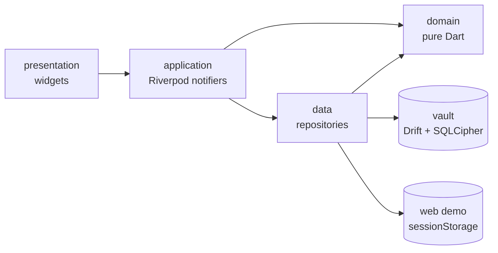

# Yaadi architecture

Yaadi turns household papers into reminders: bills, appointments, expiry dates, medicine times and tasks, in English and Urdu, on the phone and offline. This document covers Milestone 1 (a SQLCipher vault whose encryption at rest is tested on the test VM, items added by hand, the Today screen, offline search, a bilingual UI and demo households) and the decisions that leave room for later milestones:

- **M2:** reminders that repair themselves after reboots and time-zone changes, and a home-screen widget.
- **M3:** camera, PDF and share capture, using the server proxy from flutter-ai-chat-starter.
- **M4:** voice, Explain, Ask my papers, WhatsApp share and app lock.

Versions and APIs were checked on Flutter 3.47.8 and Dart 3.13.7 by running them and reading the package sources. Section 20 lists what has been verified and what has not.

## 1. Principles

- **No network on phone builds.** Android and iOS builds of M1 make no requests and work in airplane mode. The web demo serves everything from its own origin as far as Flutter allows (section 10).
- **Encrypted at rest, claimed only as far as verified.** On phones the vault is a SQLCipher database whose key the platform keystore protects. Public wording comes from section 8.
- **Never a silent reset.** Only the confirmed Reset and Delete all flows remove a vault or its key. A failure the app does not understand stops and explains.
- **Calendar values are wall-clock values.** "Due on the 10th" is a date, not an instant, so a time-zone change never moves it.
- **Domain logic is pure Dart.** Recurrence, Today grouping, the morning summary and search import no Flutter or database code; a test enforces it.
- **Only two kinds of generated code.** Drift and gen-l10n output is committed and checked in CI.

## 2. Stack

| Concern | Package | Notes |
| --- | --- | --- |
| State | `flutter_riverpod` 3.4.3 | Hand-written providers, as in the starter |
| Database | `drift` 2.35, `drift_flutter` 0.3.1 | Background isolate and a `setup` hook for the key. `shareAcrossIsolates` stays off: it cannot reach the separate engines of M2's background callbacks |
| SQLite / SQLCipher | `sqlite3` 3.8.0 | Its build hook supplies SQLCipher 4.19.0 (SQLite 3.53.4) to tests and phones (section 5.1) |
| Keys | `flutter_secure_storage` 11.2.0, `crypto` | Keystore and Keychain; HKDF-SHA256 in about 20 lines, tested against RFC 5869 |
| Text and l10n | `characters`, `flutter_localizations`, `intl` 0.20.3 | Grapheme-safe highlights; gen-l10n with ARB files |
| IDs | `uuid` 4.6.0 | UUIDv7, made offline |
| Web demo | `web` 1.1.2 | `window.sessionStorage` only |
| Fonts | Noto Nastaliq Urdu (OFL), Roboto (Apache-2.0) | Bundled; Roboto copied from the pinned Flutter SDK |
| Links | `url_launcher` 6.3.3 | The two About links open in the browser |

Not used: the end-of-life `sqlcipher_flutter_libs`, codegen for a few models (`riverpod_generator`, `freezed`), a router for four tabs, and `shared_preferences` (phone settings live in the vault).

## 3. Layers and folders

Code is organized by feature, and dependencies point inward: presentation, then application, then domain. The data layer implements interfaces the application layer depends on.



```text
lib/
  app.dart, home_shell.dart  locale, themes, text scale, gates; four tabs, a rail from 640 dp
  core/                      time, money, text, theme, platform, storage failures, widgets
  vault/                     AppStorage, VaultDatabase, keys, files, opener, setup, gate
  l10n/                      ARB files, generated localizations, Urdu material overrides
  features/
    items/                   Item, Recurrence, ItemDraft, Reference; repositories; editor, item page
    today/                   TodayView, roll-forward, reopen, MorningSummary; quick actions; screen
    search/                  normalizer, lexicon, query, index, highlights; screen
    settings/, demo/         preferences; households, seeds, badge, notice, web picker
test/                        mirrors lib/; test/drift/vault/ holds the migration harness,
                             test/fixtures/ the encrypted vault fixture (5.4)
drift_schemas/vault/         one JSON snapshot per schema version
```

`vault/` is the composition point that imports feature tables, so `core/` never imports a feature.

## 4. Data model and schema v1

### Conventions

- **IDs** are UUIDv7 text. **Dates** are `YYYY-MM-DD` text and `due_minute` is minutes after local midnight; instants are UTC milliseconds.
- **Enums** are stored by name. An older build cannot read a name it does not know, so changing a stored enum is a schema version bump; a test pins every name next to the version.
- **Money** is integer minor units plus an ISO 4217 code, both or neither. PKR by default.
- **Revision:** every write increments `revision` and compares it first. `updated_at` is for display: two writes can share a millisecond and clocks move backwards.

### Tables

`items`, one row per reminder series:

| Column | Rules |
| --- | --- |
| `id`, `kind`, `title`, `category` | UUIDv7; bill, appointment, expiry, medicine or task; 1 to 120 trimmed characters; one of 11 categories |
| `amount_minor`, `currency`, `amount_is_fixed` | Optional amount; whether it stays the same each time, by default false for electricity, gas, water and phone |
| `scheduled_on` | The rule's date for the current occurrence; completions key off it |
| `due_on`, `due_minute` | The date the user sees, equal to `scheduled_on` unless this occurrence moved; null only for undated tasks |
| `recurrence` | Typed JSON, default `{"type":"none"}` |
| `notes`, `reference` | Up to 1000 and 40 characters; the reference is masked (section 7) |
| `status`, `snoozed_until`, `completed_at` | open, done or paid; a snooze only while open; `completed_at` exactly when closed |
| `revision`, `created_at`, `updated_at` | Starts at 1; UTC ms |

`completions` has one row per Paid, Done or skipped occurrence: `item_id` (cascade on delete), `occurrence_on`, `occurrence_minute` for a dose, `outcome`, the amount at the time and `recorded_at`. It is the history and half of every undo snapshot. `settings` is a key-value table.

Every rule in `Item.violations` is also a SQL `CHECK`. A unique index on `(item_id, occurrence_on, coalesce(occurrence_minute, -1))` stops an occurrence being completed twice; a plain `UNIQUE` would not, because SQLite treats NULLs as distinct.

### Recurrence

```json
{"type":"monthly","day":31}
{"type":"yearly","month":2,"day":29}
{"type":"doses","minutes":[480,840,1200],"until":"2026-11-03"}
```

- **The anchor** (day, weekday, month) lives only in the JSON. It is derived from the date when the Repeat choice changes or when "Repeat from the new date" is on, and only while the date really differs from the original. Editing the notes of the clamped 28 February instance of a "31st" bill keeps `day: 31`; moving this month's bill from the 10th to the 13th moves this occurrence only.
- **`until`** is optional and inclusive; rolling past it closes the item.
- **`doses`** are the times the user typed, at most eight; never computed.
- **Decoding is tolerant.** An unknown type becomes `Recurrence.unsupported(raw)`, shown read-only and written back unchanged, so one newer row cannot break the list.

### Migrations

`drift_dev make-migrations` writes a snapshot per version, a step-by-step helper and test schemas that `SchemaVerifier` checks for every version pair. Migrations that touch data get data tests too. A database newer than the app opens "Update Yaadi", which never offers a reset. Schema v2 in M2 adds `remind_days_before`.

## 5. Vault: encryption and keys

### 5.1 The SQLCipher library

The `sqlite3` build hook does not compile SQLite. It fetches a prebuilt library from the package's GitHub releases, checks it against sha256 hashes shipped in the pub.dev package and bundles it; SLSA attestations are published for each file. Only `source: system` uses the operating system's copy, which Android cannot use.

**Configuration:**

```yaml
hooks:
  user_defines:
    sqlite3:
      source:
        android: sqlcipher
        ios: sqlcipher
        default: sqlcipher
```

Tests load, and CI and phone builds are configured to load, the same release's SQLCipher build: SQLCipher 4.19.0 community on SQLite 3.53.4, from the `sqlite3-3.8.0` release. The phones keep their own entries so a change to `default` never reaches them. Each platform gets its own file, fetched on first use into `.dart_tool/hooks_runner/shared/sqlite3/build/download-<hash>/` and checked against the pinned sha256 before use, also when the file is already there. A mismatch fails the build.

- **Windows VM tests** (verified): `sqlcipher.x64.windows.dll`, 4,688,896 bytes, sha256 `3a2f228b…7595`, as pinned. OpenSSL 4.0.3 is linked in statically; the DLL imports only Windows system libraries.
- **Linux CI:** `libsqlcipher.x64.linux.so`. CI caches the download directory, so the hook checks the cached file's hash again before use, and runs `gh attestation verify --repo simolus3/sqlite3.dart` after a fresh download.
- **Phones:** the Android ABIs and `libsqlcipher.arm64.ios.dylib`, fetched when a device build first runs (M2). The Apple builds use Apple's own crypto library instead of OpenSSL.

The encryption tests (`@Tags(['sqlcipher'])`, in `sqlcipher_test.dart` and `native_open_test.dart`) never skip. Without SQLCipher every one of them fails. CI also runs the tag on its own with `--run-skipped`, which fails if SQLCipher is missing, if a skip creeps in (the test runs anyway) or if no test carries the tag (exit 79). The fail-closed open (5.4) stays tested on every run: a test-only view hides the cipher pragmas the way plain SQLite does, both directly and inside a background isolate. The hook supplies one library per build, so real plain SQLite cannot run next to SQLCipher in the same test run.

The SQLCipher and OpenSSL licences are on the licence page (section 17). SQLite3MultipleCiphers (MIT, no OpenSSL) is the fallback, chosen before the first store release because switching later means a rotation.

### 5.2 Key custody

- **Secret:** 32 bytes from `Random.secure()`, stored as `{"v":1,"cipher":"sqlcipher4","kdf":"hkdf-sha256","secret":"…"}` so a cipher or custody change can migrate deliberately.
- **Derived keys:** HKDF-SHA256 with purpose labels (`yaadi/vault/sqlcipher/v1`, later `yaadi/attachments/v1`), so the secret never reaches SQLCipher and attachments never share the database key.
- **Android:** explicit options pinned by a test: `resetOnError: false`, `migrateWithBackup: true`, RSA-OAEP key wrapping, AES-GCM storage and a `yaadi_vault` namespace. The default `resetOnError: true` erases every entry on any decrypt failure, so a transient Keystore error would destroy the only key. The secret sits in SharedPreferences, encrypted with an AES key that a Keystore RSA key wraps.
- **iOS:** `first_unlock_this_device`: readable by M2 background work after the first unlock, never synced or restored elsewhere.
- The derived key goes to Drift's `setup` and is not kept in Riverpod state. `deleteAll()` is never called; only the wipe deletes the entry, by name.

### 5.3 Startup states

| Wipe marker | Key | Database | Outcome |
| --- | --- | --- | --- |
| present | any | any | Finish the wipe silently (5.6), then start fresh |
| absent | found | present | Open (5.4); a wrong key goes to Recovery |
| absent | found | absent | Delete the stale entry and start fresh; iOS keeps Keychain items across reinstalls |
| absent | missing | absent | First run: generate, write, read back and compare, then create |
| absent | missing | present | Recovery: the file cannot be read without its key |
| absent | unavailable | either | Try again; never creates a database. A reset appears after three failed attempts, behind the Delete all confirmation |

An unexpected failure, such as a full or failing disk, offers Try again only: erasing a probably healthy vault would fix none of those causes. Every cell is tested with a fake key store and a temporary directory.

### 5.4 Open path

`setup` runs in the Drift isolate: check the derived key is 64 hex characters (SQLCipher would silently run PBKDF2 on anything else); `PRAGMA key = "x'<hex>'"`, the raw-key form; require `PRAGMA cipher_version` to return a row, because plain SQLite ignores `PRAGMA key`; set `cipher_compatibility = 4`; read `sqlite_master` to check the key; then `temp_store = MEMORY`, `secure_delete = ON`, `foreign_keys = ON`, `busy_timeout = 5000` and `journal_mode = WAL`. After first creation the opener refuses a file that starts with `SQLite format 3`.

An encrypted fixture, `test/fixtures/vault_v1.sqlite`, is committed and opened on every run, so a format change in a `sqlite3` upgrade fails CI rather than phones. It is a schema v1 vault with a bill, an Urdu-titled medicine, a task, a payment and a setting. `make_vault_fixture.dart` wrote it once through the production open path, with the SQLCipher build above and a key derived by HKDF from a fixed test secret. The test copies it into a temporary vault directory, opens it through `VaultOpener` with that key and compares every row. It also checks that the fixture's bytes contain no plaintext and that a missing or different key reaches Recovery without the file changing. The generator refuses to overwrite a fixture; a new schema version adds its own file next to it.

### 5.5 Failure states

| Cause | State | Screen |
| --- | --- | --- |
| The key read threw | `keyUnavailable` | Try again (5.3) |
| No key, database present | `keyMissing` | Recovery, reset after confirmation |
| `SQLITE_NOTADB` (26) | `wrongKeyOrCorrupt` | Recovery; 26 means a wrong key, a corrupt file or plaintext alike |
| Schema or key record newer than the app | `schemaTooNew` | "Update Yaadi", no reset |
| No cipher, or a plaintext header | `cipherMissing` | Build error; development only |
| Anything else | `unexpected` | Try again, never a reset |

`storageProvider` never retries by itself; Try again re-runs the open.

### 5.6 Reset, Delete all and ordinary deletes

Reset and Delete all are the same crypto-erase: write the wipe marker, close the database, delete the key (leftover pages and copies become unreadable), delete the database, WAL, SHM and journal files, then the marker. A crash anywhere leaves the marker and the next start finishes silently.

Ordinary deletes are hard deletes. `secure_delete` overwrites freed pages, and after each delete the repository runs `PRAGMA wal_checkpoint(TRUNCATE)` so the deleted rows leave the WAL too; undo restores from a snapshot in memory, so nothing waits. Older versions of an edited row stay in the WAL until SQLite's own checkpoint. The claim is "deleted items are removed from the database file": flash storage may keep old blocks the app cannot reach, encrypted with the vault key.

### 5.7 Backups and device transfer

Android: `allowBackup="false"` and `data_extraction_rules.xml` exclude every domain from cloud backup and device transfer, including the wrapped key. iOS: the vault directory gets `NSURLIsExcludedFromBackupKey` through a small method channel. That call is best effort: an engine without the handler (M2's background engines) or a failed call never stops the vault from opening, because the file is encrypted either way and a restored copy without its key lands on Recovery. File protection stays at `CompleteUntilFirstUserAuthentication` so background opens work while locked. Both are verified on devices in M2; moving phones needs export (5.9).

### 5.8 Rotation and 5.9 export

There is no scheduled rotation for a random key that never leaves the device. A re-key after a suspected compromise or a cipher change exports into a new file under a new key, verifies it, stores the new record as pending, renames the file over the old one and promotes the record; startup resolves a pending record by trying it. Export (proposed for M2, since backups are off) writes a passphrase-protected `.yaadi` file with `sqlcipher_export`, with references only if the user opts in.

## 6. Threat model

| Protected | Not protected (and where it is handled) |
| --- | --- |
| A copy of the vault file on its own: a backup, a file dump, a misconfigured build | Someone who can unlock the phone and open Yaadi, including family on a shared phone. M1: the Reference field stays hidden. M4: app lock |
| A database restored without its key | A rooted or jailbroken phone, which can run as the app |
| Plaintext reaching disk (the cipher and header checks fail closed) | Forensic extraction from a phone unlocked since boot; malware |
| Reference numbers glimpsed on screen | App-switcher snapshots. M1 hides a shown reference when the app goes inactive, which narrows the window without closing it: Android can take the snapshot first. M4 adds a privacy cover or `FLAG_SECURE` |
| | Keyboard learning of titles and notes; screenshots; lock-screen notification text (M2); the web demo, which is plaintext in the browser |

Also accepted: the derived key stays in memory while the vault is open; losing the key means losing the vault (no escrow); budget phones may have a software-only Keystore, so nothing claims "hardware-backed".

## 7. The Reference field

- **Mask:** 8 or more letters or digits show only the last four (`•••• •••• 4821`), skipping separators; shorter values are fully masked.
- **Reveal:** Show is local widget state, undone when the route pops, when the app goes inactive or hidden, and after 30 seconds. Revealed text is not selectable and cannot be copied.
- **Editor field:** no personalized learning, autocorrect or suggestions, a `visiblePassword` keyboard and `autofillHints: null`. Only null keeps a field from the platform's autofill service; the default empty list still offers it to a password manager, which could save the number and sync it.
- **Screen readers:** hidden, it is "Reference, hidden"; shown, it is read digit by digit, and the tap hint says Show or Hide.
- **Misplaced numbers:** a CNIC-shaped value or a run of 10 digits in the title or notes triggers an offer to move it; nothing moves without a tap, and only the gap it leaves is tidied.
- References stay out of search, the morning summary, M2 notifications and widgets, and M4 share text. The claim is "the Reference field is hidden until you tap Show", never "ID numbers are hidden".

## 8. Privacy claims

The README copies these texts word for word.

**Phone builds.** Until a phone build ships and is verified on devices (M2), the README places this under the lead-in "When phone builds ship (M2), this is the statement they will carry:":

> On Android and iPhone, Yaadi keeps your items in an encrypted database on the phone (SQLCipher, AES-256). The key is created on the phone, protected by Android Keystore or stored in the iOS Keychain, and never leaves it. This version makes no network requests and has no analytics or crash reporting. Encryption protects a copy of the database file on its own. It does not protect against someone who can unlock your phone and open Yaadi, a rooted or jailbroken phone, or malware. On a shared phone, the main protection is that the Reference field is hidden until you tap Show. There is no backup yet: if you lose or reset your phone, your Yaadi data cannot be recovered.

**Status line**, above it: "Encryption at rest is tested on the desktop test runner with SQLCipher 4.19.0, from the same sqlite3 release the Android and iPhone builds bundle. The phone builds themselves, with Android Keystore, the iOS Keychain and the backup rules, are checked on devices in M2." (It said "is not tested yet" until the tests moved to SQLCipher.)

**Web demo**, on its first screen, in Settings and behind Details:

> Demo with made-up families. What you type stays in this browser, is not encrypted and is not sent to us. Do not enter real ID numbers. The demo is hosted on GitHub Pages, which keeps standard access logs.

**Never used:** military-grade, bank-level, unhackable, zero-knowledge, end-to-end, hardware-backed, "HIPAA compliant", "GDPR compliant", and "never leaves your phone" once M3 exists.

## 9. Errors and logs

`SqliteException.toString()` appends the failing statement and its parameters, which could print the key or a reference, and release builds still send errors to logcat and os_log. So the opener throws a typed failure with no SQLite text; repositories keep only the result code; the UI never interpolates an exception; Drift statement logging stays off; `toString()` on items, drafts and snapshots redacts notes and references; release error hooks keep only the error type; and `lib/` has no `print`, no logger and no crash reporter. Tests check that neither the key nor a seeded reference reaches error text.

## 10. Web demo

- **Storage.** The web build never opens a database: in-memory repositories are saved as JSON to `sessionStorage` after each write. Storage exceptions (quota, Safari private mode) are caught; the demo carries on in memory and says "This browser is not saving the demo; it will reset when you reload."
- **What sessionStorage does.** It survives a reload and belongs to one tab, but Chrome and Edge also save it to disk for session restore, and Duplicate tab copies it. Clear demo data removes the items and household and keeps language and theme.
- **Notice.** The full notice is on the household picker and in Settings; above the app's screens a one-line strip links to it with Details, so the screens keep their room at large text sizes.
- **Network.** `--no-web-resources-cdn` serves CanvasKit from the same origin; Roboto is bundled under its own name so the engine never fetches it, and the font fallback points at the same origin. A headless-browser network check through the demo found only same-origin requests.
- **Hosting.** CI builds with `--base-href /yaadi/`, and a deploy job publishes main to GitHub Pages once Pages is enabled for the repository.
- **Not Drift WASM:** it needs extra binaries and COOP/COEP headers, and would suggest a durability the demo does not have.

## 11. Today, recurrence and quick actions

**Time.** `LocalDate` arithmetic goes through `DateTime.utc`, so DST never shifts a date. For labels and pickers a date becomes a local `DateTime` at noon, because where clocks change at midnight (America/Santiago) local midnight can be missing and would fall back a day. "Today" comes from an injected clock re-read every minute and on resume. Screenshot builds pin it with `--dart-define=YAADI_TODAY=2026-11-02`.

**Groups** of open items, by effective date (a snooze while it is in force, otherwise the due date):

| Group | Contents |
| --- | --- |
| Did these happen? | Past appointments and one-off medicine times: Done or Reschedule, never "overdue" |
| Overdue | Bills, tasks and expiry dates before today |
| Today | Due today, plus each running medicine course as today's times |
| Next 7 days | The coming week, including courses that start soon |
| Expiring soon | Expiry dates 8 to 30 days away, because renewals take weeks |
| Later | Everything after, then undated tasks |

**Medicine** times are marked one by one, in any order. Past days never show as overdue or missed, and the wording stays neutral.

**Quick actions.** Paid on bills, Done on everything else and on each dose, and Snooze (1 day, 3 days, 1 week) on overdue and today's items only, because pushing a bill past a due date that has not arrived is how late fees happen. The card always shows the real due date next to a snooze.

**One write path.** Every intent becomes one `ItemChange`, applied in a transaction that first compares the item's revision. Intents name the occurrence the user saw, so a repeat while the first write is in flight is `AlreadyApplied` and says nothing; anything refused because the item changed (a repeat after the first landed, an edit, a delete) is `ActionStale` and says so; a storage failure is `ActionNotSaved`. The unique completions index backs this up.

**Roll-forward** starts from `scheduled_on`: monthly on day N clamps to short months and keeps the anchor (31 Jan, 28 or 29 Feb, 31 Mar); yearly 29 February falls on 28 February in other years; the next occurrence past `until` closes the item. The new due date equals the new scheduled date, so a moved date applies once.

**Catching up**, when the next occurrence is still in the past: a variable bill records the missed months as paid without amounts and moves to the current one, because utilities carry arrears into the next bill; a fixed instalment steps one period, since each is really owed; tasks, appointments and expiry dates jump to the current occurrence. The snack bar offers the alternatives. A fixed bill keeps its amount when it rolls; a variable bill's is cleared until the next paper.

**Undo** lasts as long as its snack bar (six seconds, or until dismissed with a screen reader on). Each snapshot holds the item before, the completions changed, the revision written and the repository written to; undo applies only there and only while the revision is unchanged. Switching to or from a demo household also clears pending snack bars, so a demo item never lands in the vault.

**Taking a completion back.** Once Undo has gone, the item page offers "Mark as not paid" (or done, or skipped) for the newest completion by occurrence: that occurrence is due again, a closed item reopens on its own date, and a variable bill gets the paid amount back. Editing the date instead would record the payment against the wrong month.

**Morning summary.** A pure function of the Today view: the overdue count and oldest title, up to three items today, the dose count, the next item this week, and bill totals per currency due by today + 7, from known amounts only, counting every instalment still owed. ICU messages render label-style lines (`آج: {title} · {amount}`), so Urdu never agrees with the gender of a typed title, and dates never break across lines.

**Tests** are table-driven: month ends and leap years, anchors under edits, catch-up, doses, snooze, the groups, idempotent Paid, a write refused between plan and apply, reopening, undo from other storage, the tolerant decoder and every 2026 date through a local `DateTime`. Dart on Windows ignores `TZ`, so Linux CI repeats the date tests in London, New York, Karachi and Santiago.

## 12. Search

Search is pure Dart over memoized token documents, with one pipeline for item text and queries in English, Urdu script and Roman Urdu.

1. **Tokenize** with marks, joiners and tatweel inside words, keeping offsets into the original text.
2. **Normalize** each token, mapping back to the original offsets: remove harakat and bidi controls; lowercase and unaccent Latin; unify Urdu letter variants (`ي ى ے` → `ی`, `ك` → `ک`, `ه ة ھ` → `ہ`, `أ إ آ` → `ا`, `ؤ` → `و`, `ں` → `ن`); turn Urdu digits into ASCII; fold Roman Urdu spellings (`ee` → `i`, `oo` → `u`, `v` → `w`, `q` → `k`, final `y` → `i`, doubled letters once), so bijlee and bijly match bijli. Keys only; display text is never altered.
3. **Tag concepts** from the household lexicon, a `const` Dart list whose terms may be phrases of up to three words, matched longest first. From `household_terms.dart`:

```dart
Concept.category(ItemCategory.electricity, [
  'electricity', 'electric', 'power', 'bijli', 'bjli', 'بجلی',
]),
Concept.category(ItemCategory.electricity, region: Region.pk, [
  'wapda', 'واپڈا', 'light', 'لائٹ',
]),
Concept.biller('lesco', ItemCategory.electricity, region: Region.pk,
    alsoWritten: ['لیسکو']),
Concept.biller('iesco', ItemCategory.electricity, region: Region.pk),
Concept.kind(ItemKind.bill, ['bill', 'invoice', 'بل']),
```

It covers the household words of both demos in all three ways of writing. A biller tags its items with its category, so "bijli" finds the LESCO bill while "lesco" never finds IESCO. Names that belong to one country apply only in its region (PKR and the Khan demo, GBP and the Taylor demo), so "Tesco" in Manchester is a shop.

**Ranking.** Fields weigh title 3.0, category and concepts 2.0, kind 1.5, notes 1.0. Match tiers come before weights: exact or concept, then prefix, then one edit, so `bill` ranks the electricity bill above "Bilal school fee". Every term must match. Ties go to open items, the nearest date, then the title.

**Typing.** The last word matches as a prefix from two letters, against both keys, and completes lexicon phrases ("shanakhti ca"). A word ending in a doubled vowel is compared by its unfolded key only, because "fee" folded to "fi" would match "final". Stopwords (`ka ki ke ko se mein hai`, `کا کی کے`, `the a of my for`) are dropped, except a lone word still being typed: "me" on its way to "meeting" keeps its results. One-edit matching (four letters or more) is off for a word that is itself a lexicon term.

**Highlights** use original offsets snapped to grapheme clusters, change only the background, and cover whole words in Arabic script, because a style change inside a word breaks Nastaliq joining.

**Index.** One document per item, reused while the item is unchanged (compared whole, since demo seeds keep ids and revisions but move dates), over a shared vocabulary so a query decides once per distinct word. Measured in the debug test VM: 4 to 13 ms per query over 5,000 items. FTS5 was rejected: its tokenizers cannot fold Urdu or Roman Urdu, and the web demo has no SQLite. A table of 90 queries pins the behaviour, including the traps (`gas` never returns electricity, `lesco` never IESCO).

## 13. Localization, RTL and type

- **Languages:** English and Urdu, from the device by default and switchable in Settings. English dates are day first (`en_GB`, which shares every English message) except in the US, since Pakistan and the UK both write 2 November 2026. Roman Urdu is understood by search, not a UI language.
- **Urdu review:** `app_ur.arb` waits for a review by a native speaker before tests pin its wording; until then Urdu tests check structure. The review also covers `Rs` against `روپے`, the part-of-day words used in times (صبح, دوپہر, شام, رات, since `intl` writes a bare "a" and "p"), and the weekday names given to Flutter's date picker, whose CLDR data uses Latin letters.
- **RTL:** directional layout throughout; LTR values inside Urdu sentences are wrapped in isolates, and left-to-right fields align with the layout's start side.
- **User text** goes through `UserText` and `AutoDirectionField`: direction from the first strong character, Nastaliq for Arabic-script runs and Roboto for the rest, each span tagged with its language so screen readers switch voice. A field keeps a Nastaliq line box from the start, so it does not grow at the first Urdu letter.
- **Urdu metrics:** line height 1.9 at every text scale (the font's own line is 2.5 em), and type 15% larger than Roboto with a 13 sp floor, because Nastaliq looks about a quarter smaller. Material's display styles stay in Roboto: they are only numerals, such as the time picker's readout, whose 80 dp box would cut a Nastaliq line in half. Inputs get 4 dp more above the text so floating labels clear گ and ک, and amounts in Urdu text stay in one typeface.
- **Input:** Urdu keyboards type Extended Arabic-Indic digits; one normalizer feeds amounts, times and search.
- **Large text** multiplies the system scale by 1.3, capped at 2.0; key screens are tested at 2.0 in both languages with the real fonts.
- **Accessibility:** headings are their own semantics nodes, quick actions carry full labels, radio groups are named, picker fields stay focusable and announce errors, a failed save is announced and focuses the first field, an empty search is announced, and tap targets are at least 48 dp. Flutter's tap-target and label guidelines run in both languages and themes; its contrast guideline misreads thin Nastaliq strokes, so colour pairs are also checked numerically at 4.5:1.

## 14. Demo mode

- Two fictional households dated relative to today: the **Khan family, Lahore** (PKR; LESCO, SNGPL, school fees, a CNIC expiry, Ammi's medicine times titled in Urdu, PTCL) and the **Taylor family, Manchester** (GBP; council tax in 10 instalments, energy, the dentist, a passport, an MOT, prescription times). Names are invented and references are obvious placeholders.
- On a phone a demo runs on its own memory repository built from the seed when chosen, so the vault is never written; the seed is read once, so midnight keeps the visitor's changes. It is rebuilt on the next launch.
- A Demo badge stays in the app bar, a strip names the household, and one tap goes back.
- The web build is always a demo: a household picker first, then the household's items in the tab's session. Switching replaces the items before the setting changes.

## 15. State

| Provider | Role |
| --- | --- |
| `clockProvider`, `todayProvider` | Injected time; today moves on at midnight, on resume and after a zone change |
| `storageProvider` | Opens storage once and exposes `AppStorage`: the repositories, the erase action and whether the browser refused a write |
| `itemRepositoryProvider` | The active item repository: a phone demo, the vault or the web session |
| `itemsProvider`, `settingsProvider` | The item stream (`readAll()` serves one-off jobs, since Riverpod 3 pauses unwatched providers); settings |
| `todayViewProvider`, `morningSummaryProvider`, `searchResultsProvider` | Derived from items and today |

Controllers expose intents and track pending writes; widgets never call repositories. All items are kept in memory, cheap at household scale; paging would come with a future sync feature, which is not on the M2 to M4 roadmap.

## 16. Testing

| Layer | What |
| --- | --- |
| Domain | Dates, recurrence, roll-forward, catch-up, reopening, doses, groups, undo snapshots, validation, money, digits, the summary, HKDF vectors |
| Search | Normalizer, lexicon and regions, tiers, typing rules, highlights, 90 queries, a 5,000-item budget |
| Repository | One contract suite per repository type, run against Drift, memory and the session store, including a store that throws |
| Vault | Migrations, enum names against the schema version, CHECKs, the WAL after a delete, the startup matrix, failure mapping, wipe crash points, the open failing closed without SQLCipher (simulated, 5.1) |
| Vault, `sqlcipher` tag | SQLCipher 4.x with OpenSSL loaded; file and WAL never plaintext, with no plaintext header; no key means "not a database"; a wrong key or a plaintext file reaches Recovery untouched; the production open in drift_flutter's isolate applies every setting; startup creates the vault and reopens it with the stored key; the committed fixture opens through the startup path, and a missing or different key sends it to Recovery. Never skipped; CI also runs the tag on its own |
| Widgets | Today, quick actions with Undo and stale feedback, the editor's rules and announcements, the Reference field, delete, taking a payment back, search, demo households on a phone and the web, the Urdu time picker, layouts, large text, accessibility guidelines on six screens |
| Theme and sources | Colour pairs at 4.5:1, Urdu line heights at 1.0, 1.3 and 2.0; no `print`, no TODOs, pure domain, no literal bidi characters or byte-order marks |

Widget tests load the real fonts, because the test font draws Urdu as boxes and hides clipping. A tap that lands only because an ancestor catches it fails. No test touches the network or a real platform channel; only the sqlite3 hook downloads, once, before the first test run (5.1). Planned (M2): golden images of Today and the editor in both languages, rendered on Linux CI.

## 17. CI, licences and reproducibility

GitHub Actions on Ubuntu with Flutter 3.47.8, read-only token permissions, one run per branch and a 30-minute limit: restore the cached SQLCipher download and install lcov; check that `gen-l10n`, `build_runner`, `make-migrations` and `schema generate` change nothing and that no message is untranslated; `dart format`; `flutter analyze`; `flutter test --coverage` with an lcov summary in the job summary; the `sqlcipher` tag again on its own with `--run-skipped`; `gh attestation verify` on a freshly downloaded SQLCipher library; the date tests again in four time zones; a release web build, deployed to Pages from main. Dependabot watches `pub` and `github-actions`. The CHANGELOG notes every `sqlite3`, SQLCipher or OpenSSL change, since their security fixes arrive through `sqlite3` releases.

The Noto Nastaliq Urdu and Roboto licences ship in `assets/fonts` and appear on the in-app licence page. The SQLCipher and OpenSSL notices ship in `assets/licenses`. `registerBundledLicenses` adds SQLCipher to the licence page of phone builds, and OpenSSL where the library links it: Android, not iOS. The web demo has no database library and lists neither. A test checks both platforms. Desktop is left out of M1: Windows plugin builds need Developer Mode, and desktop keyrings need their own threat-model rows.

## 18. Later constraints (M2 to M4)

- **Notifications (M2).** Scheduled notifications are stored outside the vault, so payloads carry the item id and generic text. Rescheduling runs after the first unlock, because the key is unavailable before it. Notification ids are 32-bit, so schema v2 maps them to UUIDs. Nonexistent local times move to the next valid minute; ambiguous ones take the first.
- **Background access (M2).** Separate engines open their own connections, kept safe by WAL, `busy_timeout` and file locking.
- **Widget (M2).** Counts by default, titles only on request; Settings says that data lives outside the vault.
- **Capture (M3).** Photos and PDFs are encrypted file by file under keys derived from the vault secret; temporary copies are deleted and nothing goes to the gallery.
- **Server (M3).** "Our server stores nothing" becomes checkable statements: no copies, no payload logs, the provider's retention named.
- **App lock (M4).** A UI gate that never becomes the only custody of the key and never blocks background work.
- **Share (M4)** never includes references. **Sync (future)** needs tombstones for hard deletes. **Desktop** fails closed without a keyring.

## 19. Trade-offs

| Decision | Instead of | Why, and the cost |
| --- | --- | --- |
| SQLCipher from the hook's pinned binaries | Compiling it; SQLite3MultipleCiphers | Hash-pinned, attested, one build for tests and phones. Cost: a fetched binary and 5 to 6.5 MB per Android ABI |
| Versioned key record, HKDF-derived keys | The stored key directly | Cipher changes and attachments need no improvised migration |
| No reset on keystore errors | Plugin defaults | A transient error cannot erase the key. Cost: a stuck user sees Try again |
| Crypto-erase for Reset and Delete all | Deleting files | Leftover pages and copies become unreadable |
| Backups excluded on both platforms | Encrypted iOS backups | No restore landing on Recovery. Cost: no restore until export |
| Web demo on memory and sessionStorage | Drift WASM | No extra binaries or headers, an honest demo. Cost: more repositories, kept in line by contract suites |
| Wall-clock dates | UTC instants | Zone changes never move due dates. Cost: conversion for notifications |
| One row per series, a completion log, derived doses | One row per occurrence | Stable ids and doses marked in any order. Cost: Today expands doses daily |
| Revision counter | `updated_at` | Cannot collide or move with the clock |
| Catch-up by bill type | One rule | No invented arrears, no lost instalments. Cost: an `amount_is_fixed` flag |
| Undo tied to its repository | Any repository shown | A demo item never enters the vault. Cost: an Undo is lost when storage switches |
| Pure-Dart search | FTS5 | Urdu and Roman Urdu folding, works on the web. Cost: linear work per keystroke, measured |
| Hard delete, `secure_delete`, WAL truncation | Soft delete | Deleted items leave the file. Cost: Undo lasts only while its snack bar shows |
| Nastaliq line height fixed at 1.9 | Easing it down at large scales | Large text stays readable. Cost: taller Urdu rows at 2.0 |

## 20. Verified and not verified yet

Verified on Flutter 3.47.8 (Windows VM tests and a release web build): the packages resolve and Drift runs in tests; the migration harness works; the sqlite3 hook fetches `sqlcipher.x64.windows.dll` and its sha256 matches the pinned hash; encryption at rest on SQLCipher 4.19.0 (no plaintext in the file, its WAL or its header, "not a database" without the key, a wrong key, a missing key and a plaintext file all reaching Recovery without the file changing, and the production open in drift_flutter's isolate); the committed fixture opens through the startup path; the open path refuses a build without SQLCipher (simulated, 5.1) and leaves a 0-byte file and a key-free error; a delete leaves nothing in the WAL under the vault's PRAGMAs; Urdu, RTL and large text render with the real fonts; the web bundle has no native database code and the demo made only same-origin requests. The package behaviour this design leans on (sections 2, 5.2, 9 and 10) was read in the sources.

Not verified yet: the CI workflow, which first runs when the repository is pushed, and with it the Linux SQLCipher library, its cache, `gh attestation verify` and the date tests in real time zones; the Android and iOS SQLCipher libraries, fetched when a device build first runs; the Android and iOS backup rules and Keystore options on devices (M2); golden images (M2).

## 21. Changes from the original plan

| Change | Why |
| --- | --- |
| Intents reach the repository as one `apply(ItemChange)` that compares the revision | One check works the same in all three repositories, and undo takes the same path |
| Billers are their own concept type | "bijli" must find the LESCO bill while "lesco" must not find IESCO |
| Expiry dates 8 to 30 days away have their own group | "Next 7 days" listed a CNIC 23 days away |
| Delete happens at once with Undo | The snapshot restores the item and its history; Delete all still asks |
| "Mark as not paid" on the item page | Without it, editing the date was the only way back, and it recorded payments against the wrong month |
| The Nastaliq line height no longer eases down at large scales | The easing made lines collide in Large text, the opposite of its purpose |
| Golden tests moved to M2 | Their baselines need the Linux CI run that publishing brings |
| The `sqlcipher` tests never skip, and CI runs the tag on its own with `--run-skipped` instead of setting `YAADI_REQUIRE_SQLCIPHER=1` | Every configuration now loads SQLCipher, so a skip could only hide a broken build. The separate run also fails when no test carries the tag |
| Fail-closed tests simulate a build without SQLCipher | The hook supplies one library per build, and tests now get SQLCipher |
| SQLCipher moved to the test VM in M1 instead of M2 | Encryption at rest is tested before any phone build exists; device checks stay in M2 |
