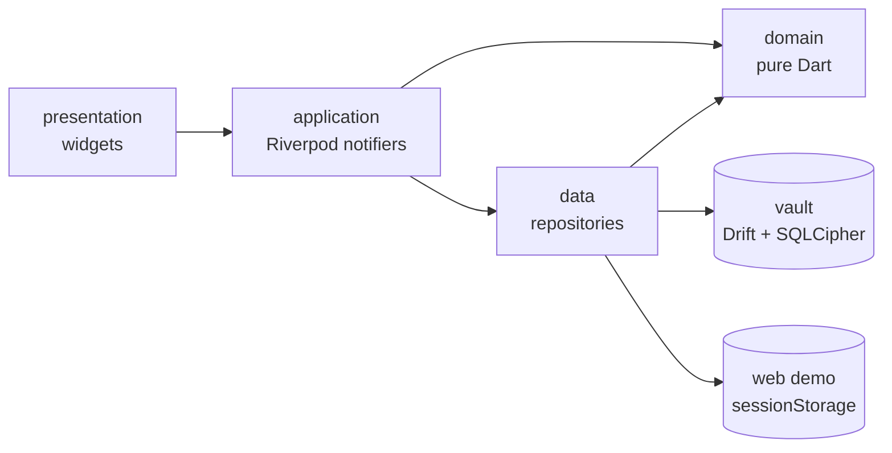

# Yaadi architecture

Yaadi turns household papers into reminders: bills, appointments, expiry dates, medicine times and tasks, in English and Urdu, on the phone and offline. This document covers Milestone 1 (encrypted vault, items added by hand, Today screen, offline search, bilingual UI, demo households) and the decisions that keep room for later milestones:

- **M2:** reminders that repair themselves after reboots and time-zone changes, plus a home-screen widget.
- **M3:** camera, PDF and share capture, using the server proxy from flutter-ai-chat-starter.
- **M4:** voice, Explain, Ask my papers, WhatsApp share and app lock.

Package versions and APIs below were checked on Flutter 3.47.8 stable and Dart 3.13.7 (27 Oct 2026), with a throwaway probe project and by reading the package sources. Section 19 lists what was proved and what was not.

One decision is still open: whether the build may download the hash-pinned SQLCipher binaries (section 5.1). Until it is made, nothing in this repository claims that encryption has been tested.

## 1. Principles

- **No network on phone builds.** Android and iOS builds of M1 make no network requests and work in airplane mode. The web demo serves everything from its own origin as far as Flutter allows; section 10 names the exceptions.
- **Encrypted at rest, and claimed only as far as verified.** On Android and iOS the vault is a SQLCipher database whose key the platform keystore holds. Public wording comes from section 8 and changes only when the threat model does. The web build is a demo and says so on screen.
- **Never a silent reset.** Only the confirmed Reset and Delete all flows remove a vault or the key that opens it. A failure the app does not understand stops and explains.
- **Calendar values are wall-clock values.** "Due on the 10th" is a date, not an instant. Dates and times are stored the way the paper states them, so a time-zone change never moves a due date.
- **Domain logic is pure Dart.** Recurrence, Today grouping, the morning summary and search have no Flutter or database imports. They run the same way on the VM, on a device and on the web.
- **Only two kinds of generated code.** Drift and gen-l10n output is committed and checked in CI. Everything else is hand-written.

## 2. Stack

| Concern | Package (version) | Notes |
| --- | --- | --- |
| State | `flutter_riverpod` 3.4.3 | Manual providers, no generator (same style as the starter) |
| Database | `drift` 2.35.3, `drift_dev` 2.35.2, `drift_flutter` 0.3.1 | Background isolate, the Android temp-dir fix and a `setup` hook for the key. `shareAcrossIsolates` stays off: it finds databases through `IsolateNameServer`, which does not reach the separate Flutter engines M2's background callbacks run in (section 18) |
| SQLite / SQLCipher | `sqlite3` 3.8.0 | A Dart build hook supplies the library; `pubspec.yaml` chooses which one (section 5.1) |
| Key storage | `flutter_secure_storage` 11.2.0 | Android Keystore (RSA-OAEP wraps an AES-GCM key), iOS Keychain. The plugin needs minSdk 24, which is also Flutter 3.47's default |
| Key derivation | `crypto` 3.0.x | HMAC-SHA256 for HKDF (RFC 5869), about 20 lines, tested against the RFC vectors |
| Text | `characters` | Grapheme clusters for highlight spans |
| Localization | `flutter_localizations`, `intl` 0.20.3 | gen-l10n with ARB files; `flutter_localizations` sets the `intl` range (`^0.20.3`) |
| IDs | `uuid` 4.6.0 | UUIDv7: time-ordered and generated offline |
| Web demo storage | `web` 1.1.2 | `window.sessionStorage` only |
| Fonts | Noto Nastaliq Urdu (OFL), Roboto (Apache-2.0) | Nastaliq from the official Noto/Google Fonts GitHub. Roboto is copied from the pinned Flutter SDK's `material_fonts` artifact with its licence, so it needs no download |
| Icons | `cupertino_icons` | Kept: without it the probe's `flutter build web` warned about the CupertinoIcons font that framework widgets reference |
| Tooling | `build_runner` 2.17.1, `flutter_lints` 6, `flutter_launcher_icons`, `fake_async` | The starter's `analysis_options.yaml` (strict casts plus its extra rules); `fake_async` drives the midnight ticker in tests |

Deliberately not used:

- `sqlcipher_flutter_libs` and `sqlite3_flutter_libs` are end-of-life (`0.7.0+eol`, `0.6.0+eol`) and do nothing with `sqlite3` 3.x. Both still appear in `pubspec.lock` as transitive dependencies of `drift_flutter` 0.3.1, where they are empty guards.
- `riverpod_generator` and `freezed` would add codegen for a handful of models.
- `go_router`: three tabs and a few pushes need no router before M3 deep links.
- `shared_preferences`: phone settings live inside the vault.

## 3. Layers and folders

The code is organized by feature. Each feature has up to four layers, and dependencies point inward: presentation, then application, then domain. The data layer implements interfaces the application layer depends on.



```text
lib/
  main.dart                      ProviderScope, licence registration, then the vault gate
  app.dart                       MaterialApp: locale, themes, text scale
  home_shell.dart                tabs, web demo notice
  core/
    ids.dart                     UUIDv7 generator provider
    time/                        LocalDate, clock provider, midnight and time-zone ticker, time-of-day format
    money/                       Money (minor units + currency), formatting, decimal parsing
    text/                        digits, bidi controls and script detection shared by input and search
    theme/                       Material 3 light/dark, Urdu typography and metrics
    widgets/                     UserText, AutoDirectionField
    platform/                    session_store (conditional web/memory), iOS backup exclusion
    storage/                     StorageFailure: result codes only, no SQL text
  vault/
    app_storage.dart             AppStorage, StorageBackend, storageProvider
    vault_database.dart          @DriftDatabase composition root (+ .g.dart, .steps.dart)
    vault_key_store.dart         key record, interface, flutter_secure_storage implementation
    vault_keys.dart              HKDF derivation
    vault_files.dart             paths, existence checks, wipe marker
    vault_opener.dart            startup states and the crypto-erase
    vault_setup.dart             the SQLCipher PRAGMA sequence (section 5.4)
    vault_failure.dart           failure kinds and their mapping
    open_vault_native.dart       SQLCipher open (conditional import)
    open_vault_web.dart          web: no vault, session repositories instead
    session_demo_backend.dart    the web demo's storage backend
    vault_gate.dart              opening / ready / try again / recovery / update screens
  l10n/                          app_en.arb, app_ur.arb, generated app_localizations*.dart
  features/
    items/      domain: Item, ItemKind, ItemCategory, ItemStatus, Recurrence, ItemDraft validation, UndoSnapshot
                data: tables, ItemRepository, DriftItemRepository, MemoryItemRepository
                application: items controller (save, delete, undo)
                presentation: list, editor, detail, reference field
    today/      domain: TodayView (grouping), doses, roll-forward and catch-up, snooze, MorningSummary
                application: today providers, quick actions, morning summary text; presentation
    search/     domain: tokenizer and normalizer, household terms and lexicon, query, index, highlights
                application: search providers; presentation (highlighted results)
    settings/   domain, data (SettingsRepository: vault and session), application, presentation
    demo/       data: Khan family (Lahore), Taylor family (Manchester); application
test/                            mirrors lib/; test/drift/vault/ holds the migration harness
test/flutter_test_config.dart    loads Roboto and Noto Nastaliq Urdu for widget and golden tests
test/fixtures/                   encrypted fixture database (once section 5.1 is approved)
drift_schemas/vault/             drift_schema_vN.json, one per schema version
assets/fonts/                    Noto Nastaliq Urdu Regular/Bold + OFL.txt, Roboto Regular/Medium/Bold + LICENSE
```

`vault/` is the composition point that imports feature tables, so `core/` never imports a feature. A small test fails if any `domain/` file imports Flutter or Drift.

## 4. Data model and schema v1

### Conventions

- **IDs:** UUIDv7 text. They are made offline and sort by creation time, and they will merge safely if Phase 3 adds family sharing.
- **Calendar values:** dates are `YYYY-MM-DD` text and `due_minute` is minutes after local midnight. Instants (`created_at`, `updated_at`, `completed_at`, `recorded_at`) are UTC milliseconds.
- **Enums** are stored as their Dart names (`textEnum`). Reordering an enum is safe; renaming one needs a migration.
- **Money** is an integer number of minor units plus an ISO 4217 code, never a double. Both are null or both are set. The default currency is PKR; the English demo uses GBP or USD.
- **Revision:** every write to an item increments `revision`. Quick actions and undo compare it before writing. `updated_at` is for display only, because two writes can share a millisecond and the device clock can move backwards.
- **Recurrence** is a typed JSON value in one text column, read through a tolerant Drift type converter (see below).

### Tables

`items`: one row per reminder series.

| Column | Type | Rules |
| --- | --- | --- |
| `id` | TEXT PK | UUIDv7 |
| `kind` | TEXT | `bill`, `appointment`, `expiry`, `medicine`, `task` |
| `title` | TEXT | 1 to 120 characters after trimming |
| `category` | TEXT | `electricity`, `gas`, `water`, `internet`, `phone`, `school`, `rent`, `health`, `idDocument`, `warranty`, `other` |
| `amount_minor` | INTEGER NULL | 0 or more. For a variable bill, the current bill's amount, only once it is known |
| `currency` | TEXT NULL | three letters; set exactly when the amount is set |
| `amount_is_fixed` | INTEGER (bool) | Defaults by category: false for electricity, gas, water and phone, true otherwise. Decides catch-up and whether roll-forward keeps the amount |
| `scheduled_on` | TEXT NULL | the rule's date for the current occurrence; completions are keyed by it |
| `due_on` | TEXT NULL | the date the user sees; equals `scheduled_on` unless the user moved this occurrence; null only for undated tasks |
| `due_minute` | INTEGER NULL | 0 to 1439 |
| `recurrence` | TEXT | JSON, default `{"type":"none"}` |
| `notes` | TEXT NULL | up to 1000 characters |
| `reference` | TEXT NULL | up to 40 characters; masked (section 7), never indexed, never in summaries |
| `status` | TEXT | `open`, `done`, `paid` |
| `snoozed_until` | TEXT NULL | local date; cleared on completion and when `due_on` is edited |
| `completed_at` | INTEGER NULL | set when a one-off item is done or paid, or a series passes its `until` |
| `revision` | INTEGER | starts at 1 |
| `created_at`, `updated_at` | INTEGER | UTC ms |

For medicine on a `doses` rule, `scheduled_on` and `due_on` hold the first day of the course and never move. Each day's doses are derived from the rule (section 11).

`completions`: one row per Paid, Done or skipped occurrence. It keeps history for later features (bill chart, dose history) and is half of every undo snapshot.

| Column | Type | Rules |
| --- | --- | --- |
| `id` | TEXT PK | UUIDv7 |
| `item_id` | TEXT | FK to `items.id`, `ON DELETE CASCADE` |
| `occurrence_on` | TEXT | the scheduled date that was completed |
| `occurrence_minute` | INTEGER NULL | the dose time; null for everything except doses |
| `outcome` | TEXT | `paid`, `done`, `skipped` |
| `amount_minor`, `currency` | INTEGER NULL, TEXT NULL | amount at that time (bills change every month) |
| `recorded_at` | INTEGER | UTC ms |

`settings`: `key TEXT PK, value TEXT`. It holds language, theme, large text, the default currency and the selected demo household.

Indexes:

- `items(status, due_on)`.
- `CREATE UNIQUE INDEX completions_occurrence ON completions(item_id, occurrence_on, coalesce(occurrence_minute, -1))`. SQLite treats NULLs in a UNIQUE constraint as distinct, so a plain `UNIQUE(item_id, occurrence_on, occurrence_minute)` would still let an untimed occurrence be completed twice.

Constraints are written as SQL `CHECK`s and also validated by Drift, so a bad row fails at the boundary, not in the UI.

### Recurrence

```json
{"type":"none"}
{"type":"daily","until":"2026-11-07"}
{"type":"weekly","weekday":5}
{"type":"monthly","day":31}
{"type":"monthly","day":1,"until":"2027-01-01"}
{"type":"yearly","month":2,"day":29}
{"type":"doses","minutes":[480,840,1200],"until":"2026-11-03"}
```

- **The anchor** (day, weekday, month) lives only in the JSON. It is derived from the due date when the user sets or changes the Repeat field, and at no other time. Editing the notes of the 28 February instance of a "31st" series keeps `day: 31`. Moving this month's due date from the 10th to the 13th (Pakistani utility dates shift with the meter-reading date) changes `due_on` for this occurrence only.
- **`until`** is optional on every rule and inclusive. Rolling forward past it completes the item. A 5-day antibiotic course, a school-year fee and UK council tax (10 monthly instalments, April to January) all use it.
- **`doses`** are the times the user typed, sorted, unique, at most eight. They are never computed from an interval or a dose amount.
- **Decoding is tolerant.** Unknown keys are ignored. An unknown `type` or an invalid value decodes to `Recurrence.unsupported(raw)`: the item renders read-only with "Made by a newer version of Yaadi", and its JSON is written back unchanged. One row from a newer build (after a downgrade, or from Phase 3 sync) cannot break `watchAll()` and with it the app.
- An `interval` key is reserved for "every 3 months" and can be added without a schema change.

### Migrations

`drift_dev make-migrations` produces three things:

- a JSON snapshot per schema version;
- a generated `stepByStep` helper;
- per-version test schemas that `SchemaVerifier` checks for every from/to pair.

Migrations that touch existing data also get hand-written data-integrity tests. A database newer than the app opens the `SchemaTooNew` screen, which never offers a reset (section 5.5). The probe ran a real v1 to v2 step (adding a reminder lead-time column, the planned M2 change) and the generated tests passed on the Windows VM.

## 5. Vault: encryption and keys

### 5.1 Open decision: the SQLCipher binary

The `sqlite3` 3.8.0 build hook never compiles SQLite. It downloads a prebuilt library from the package's GitHub releases (github.com/simolus3/sqlite3.dart), checks it against the sha256 hashes shipped in the pub.dev package (`lib/src/hook/asset_hashes.dart`) and bundles it. SLSA level 3 attestations are published for each file. The plain default build (`source: sqlite3`) is fetched the same way, so leaving the setting out does not avoid a download. Only `source: system` uses a copy from the operating system, and Android cannot use it because the platform SQLite is not a public NDK library. Every Android and iOS build therefore needs this download, whatever M1 decides.

The approved downloads are pub.dev packages and the Noto Nastaliq Urdu font. GitHub release assets are neither, so this needs its own yes. The files involved:

| Used by | Files |
| --- | --- |
| `flutter test` on Windows | `sqlcipher.x64.windows.dll` (links OpenSSL) |
| `flutter test` on Linux CI | `libsqlcipher.x64.linux.so` (links OpenSSL) |
| Android builds (M2) | `libsqlcipher.{arm,arm64,x64}.android.so`, about 5 to 6.5 MB per ABI before compression |
| iOS builds (M2) | `libsqlcipher.arm64.ios.dylib` and the simulator builds, about 1.8 MB |

**Current configuration (not approved), taken from the probe:**

```yaml
hooks:
  user_defines:
    sqlite3:
      source:
        android: sqlcipher
        ios: sqlcipher
        default: system
      name:
        windows: winsqlite3
```

VM tests use the operating system's SQLite (`winsqlite3` on Windows, `libsqlite3` on the Linux runner), so `flutter test` downloads nothing. Android and iOS are already set to SQLCipher, and no M1 step builds them. The encryption tests carry `@Tags(['sqlcipher'])` and skip with the reason "needs the SQLCipher test library (ARCHITECTURE.md section 5.1)". The README uses the "not tested yet" status line from section 8.

**If approved:**

```yaml
hooks:
  user_defines:
    sqlite3:
      source: sqlcipher
```

VM tests and phones then use the same SQLCipher build, and the opener and its tests (section 16) are built before any feature work. CI sets `YAADI_REQUIRE_SQLCIPHER=1`, which turns the skip into a failure, so the encryption tests become mandatory. CI caches the hook output keyed on the `sqlite3` version, and on a cache miss runs `gh attestation verify --repo simolus3/sqlite3.dart` on the fetched library. The README switches to the "tested on the desktop test runner" status line.

Either way the vault refuses to open without SQLCipher (section 5.4), so a misconfigured build fails closed instead of writing plaintext.

SQLite3MultipleCiphers (MIT, no OpenSSL, smaller) is the fallback. Switching later means a rotation (section 5.8), so the choice is fixed before the first store release.

### 5.2 Key custody

- **Secret:** 32 bytes from `Random.secure()`, generated on the phone.
- **Stored record:** `{"v":1,"cipher":"sqlcipher4","kdf":"hkdf-sha256","secret":"<64 hex>"}` under a single entry. The version and cipher fields let a later cipher or custody change migrate deliberately instead of guessing.
- **Derived keys:** HKDF-SHA256 with a purpose label: `yaadi/vault/sqlcipher/v1` now, `yaadi/attachments/v1` in M3. The secret itself never reaches SQLCipher, and attachments never share the database key.
- **Android options**, set explicitly and pinned by a unit test of `AndroidOptions.toMap()`:

  ```dart
  const vaultAndroidOptions = AndroidOptions(
    resetOnError: false,
    migrateWithBackup: true,
    keyCipherAlgorithm: KeyCipherAlgorithm.RSA_ECB_OAEPwithSHA_256andMGF1Padding,
    storageCipherAlgorithm: StorageCipherAlgorithm.AES_GCM_NoPadding,
    storageNamespace: 'yaadi_vault',
  );
  ```

  The plugin's default, `resetOnError: true`, erases every stored entry on any decrypt failure and returns null. A transient Keystore error, or an OEM keystore bug after an OS update, would then destroy the only copy of the key and look like an empty keystore. Pinned algorithms mean a plugin release that changes its defaults cannot migrate the key by itself, and `migrateWithBackup` keeps a copy if a migration ever runs. `storageNamespace` isolates the preferences file and the Keystore aliases, so an error on a later secret (the M3 server token gets its own namespace) cannot touch the vault key.
- **iOS:** `KeychainAccessibility.first_unlock_this_device`. M2 background work can read the key once the phone has been unlocked after a reboot, and the key never syncs to another device or restores onto a new one.
- **In memory:** the record is read, the derived key is handed to Drift's `setup`, and both are dropped. Neither is kept in Riverpod state. The derived key does stay in the database isolate's memory while the vault is open.
- `deleteAll()` is never called. The vault entry is deleted by name, only by the wipe in section 5.6.

`VaultKeyStore` returns one of three results: `KeyFound(record)`, `KeyMissing` (the read returned null) or `KeyUnavailable` (the read threw a `PlatformException`). Tests use an in-memory fake that can produce each one; only the native implementation touches `flutter_secure_storage`.

### 5.3 Startup states

The database lives at `<applicationSupport>/vault/vault.sqlite`. The existence check and drift_flutter's `databaseDirectory` use the same function, so they can never disagree about where the file is. The wipe marker is `<applicationSupport>/vault.wipe`, outside the directory it protects.

| Wipe marker | Key read | Database file | Outcome |
| --- | --- | --- | --- |
| present | any | any | Finish the wipe silently (section 5.6), then continue as "missing, absent" |
| absent | found | present | Open (section 5.4). A wrong key leads to the Recovery screen |
| absent | found | absent | Delete the stale entry, generate a new key, create the database. This covers iOS reinstalls (Keychain items survive uninstall) and a crash between writing the key and creating the file |
| absent | missing | absent | First run: generate, write, read back and compare, then create. A key that failed to persist never encrypts a file |
| absent | missing | present | Recovery screen: the database cannot be read without its key |
| absent | unavailable | either | Try again screen. It never creates a database. A reset appears only after three failed attempts, behind the same confirmation as Delete all |

Every cell is tested with the fake key store and a temporary directory.

### 5.4 Open path

`setup` runs inside the Drift background isolate, in this order:

1. Check the derived key against `^[0-9a-f]{64}$`. SQLCipher treats anything else as a passphrase and silently runs PBKDF2 on it, which would produce a file keyed differently from what the app believes.
2. `PRAGMA key = "x'<hex>'"`. The raw-key form skips passphrase derivation (PBKDF2, 256,000 rounds), which would cost noticeable startup time on budget phones and adds nothing for a random key.
3. `PRAGMA cipher_version` must return a row. Plain SQLite ignores `PRAGMA key` without an error; this check makes such a build refuse to open.
4. `PRAGMA cipher_compatibility = 4`, so a future `sqlite3` release that moves to SQLCipher 5 defaults cannot change how existing files are read.
5. `SELECT count(*) FROM sqlite_master` checks the key at once.
6. `temp_store = MEMORY`, `secure_delete = ON`, `foreign_keys = ON`, `busy_timeout = 5000`, then `journal_mode = WAL`. The WAL file is encrypted too.

After the database is first created, the opener reads the first 16 bytes of the file and refuses to continue if they are `SQLite format 3\0`. This fail-closed check runs on the device itself, on top of the VM test.

A small encrypted fixture database, made once with the approved build, is committed under `test/fixtures/`. A test opens it on every run, so a `sqlite3` upgrade that changes the SQLCipher format fails CI instead of failing on phones.

### 5.5 Failure states

Errors raised in the background isolate arrive wrapped in `DriftRemoteException`. The opener unwraps them and maps each cause to one state:

| Cause | State | Screen |
| --- | --- | --- |
| The key read threw | `KeyUnavailable` | Try again (section 5.3) |
| No key, database present | `KeyMissing` | Recovery: explains what happened, including "restored onto a new phone", and offers a reset after confirmation |
| `SqliteException` code 26 (`SQLITE_NOTADB`) | `WrongKeyOrCorrupt` | Recovery. SQLCipher returns 26 for a wrong key, a corrupt file and a plaintext file alike, so the screen does not pretend to know which |
| Database schema newer than the app | `SchemaTooNew` | "Update Yaadi". No reset: the vault is healthy and the app is old, for example a sideloaded older APK |
| `cipher_version` empty, or the header check failed | `CipherMissing` | Build error screen; only possible in development |

`vaultProvider` does not retry by itself; Try again re-runs the open. Each mapping is tested through the real background-isolate open path once section 5.1 is approved.

### 5.6 Reset, Delete all and ordinary deletes

Reset (from Recovery) and Settings > Delete all are the same crypto-erase:

1. Write the `vault.wipe` marker.
2. Close the database.
3. Delete the key entry. From here on, leftover pages and any copies of the file cannot be read.
4. Delete `vault.sqlite`, `vault.sqlite-wal`, `vault.sqlite-shm` and `vault.sqlite-journal`.
5. Delete the marker.

A crash anywhere in between leaves the marker, and the next start finishes the job silently instead of showing a frightening "key missing" screen. Each step is crash-tested with the fake key store.

Ordinary deletes are hard deletes. `secure_delete = ON` overwrites freed pages, and once a delete is past its undo window the repository runs `PRAGMA wal_checkpoint(TRUNCATE)` so old WAL frames go too. The claim is "deleted items are removed from the database file" and nothing stronger: flash storage can keep old blocks the app cannot reach, though those blocks are encrypted with the vault key.

### 5.7 Backups and device transfer

- **Android:** `allowBackup="false"` covers API 30 and below. On API 31 and above `allowBackup` no longer stops device-to-device transfer, so `res/xml/data_extraction_rules.xml` does the work: both `<cloud-backup>` and `<device-transfer>` exclude the `root`, `file`, `database`, `sharedpref` and `external` domains and their `device_root`, `device_file`, `device_database` and `device_sharedpref` counterparts. flutter_secure_storage keeps the wrapped key in SharedPreferences, so it is excluded with everything else.
- **iOS:** the database lives in `Application Support/vault/`, and that directory gets `NSURLIsExcludedFromBackupKey` (a few lines of Swift in Runner behind a method channel). The flag on the directory also covers the WAL and SHM files that SQLite recreates. File protection stays at the default `NSFileProtectionCompleteUntilFirstUserAuthentication`, never `Complete`, or M2's background opens would fail while the phone is locked. Without the exclusion, an iCloud or Finder restore onto a new iPhone would bring back the file without its this-device-only key and land on the Recovery screen.
- **Moving phones** needs export (section 5.9). Until it exists, the README says so plainly (section 8).

The Android XML and the Swift code are written in M1 and verified on devices in M2: `adb shell bmgr backupnow <package>` on the local transport, and one real transfer (Smart Switch or D2D). The expected result is a fresh install. If an OEM tool copies the files anyway, the result must be the Recovery screen, never a crash and never plaintext.

### 5.8 Rotation

There is no scheduled rotation: a random key that never leaves the device gains nothing from it. The vault is re-keyed when the user asks after a suspected compromise, and when the cipher or the key custody changes (a SQLCipher major version, the SQLite3MultipleCiphers fallback). The procedure is export-and-swap, preferred over an in-place `PRAGMA rekey` in WAL mode:

1. `sqlcipher_export` into `vault.next.sqlite` under a new key.
2. Verify with `PRAGMA cipher_integrity_check` and row counts.
3. Store the new record as pending.
4. Rename the new file over the old one atomically.
5. Promote the pending record and delete the old one.

A crash at any step leaves a usable pair; startup resolves a pending record by checking which key opens the file.

### 5.9 Export format (fixed now, built later)

Export writes a passphrase-protected `.yaadi` file: `ATTACH` a new database keyed by the user's passphrase and `sqlcipher_export` into it. That reuses SQLCipher's PBKDF2-HMAC-SHA512 (256,000 iterations) and needs no new crypto dependency. The schema version is stored inside, references are included only if the user opts in, and a plaintext CSV is offered only behind an explicit warning. Because backups are off on both platforms, a minimal export is proposed for M2 instead of M4.

## 6. Threat model

| Protected | Not protected (and where it is handled) |
| --- | --- |
| A copy of the vault file on its own (from a backup, a file dump or a misconfigured build), on top of Android and iOS storage encryption | Someone who can unlock the phone and open Yaadi, including a family member who knows a shared phone's PIN. M1: the Reference field stays hidden (section 7). M4: app lock |
| A database file restored without its key (a new phone, an OEM transfer tool) | A rooted or jailbroken phone: whoever can copy app-private files can also run as the app and have the Keystore unwrap the key |
| Plaintext reaching disk through a misconfigured build (the cipher and header checks fail closed) | Forensic extraction from a phone that has been unlocked since boot |
| Reference numbers glimpsed on screen (hidden by default, section 7) | Malware, including Android accessibility-service malware that reads screen text |
| | App-switcher snapshots: Android recents and iOS `Library/Caches/Snapshots` write a picture of the last screen to disk. M1 re-masks references on `AppLifecycleState.inactive` and `hidden`. M4 adds an optional privacy cover, `FLAG_SECURE` or, on Android 13 and later, `setRecentsScreenshotEnabled(false)` |
| | Keyboard learning: Gboard, SwiftKey and others learn typed titles and notes, sometimes with cloud sync. The Reference field opts out (section 7); titles and notes cannot without making typing worse |
| | Screenshots and screen recorders (M4) |
| | Notification text on the lock screen (M2, section 18) |
| | The web demo: plaintext in the browser (section 10) |
| | Desktop builds: none in M1, and no claims until each platform has its own row (section 18) |

On a shared phone, the main M1 protection is the hidden Reference field. The README says this in those words.

Other accepted limits:

- The derived key stays in process memory while the vault is open (Dart strings cannot be wiped).
- File size and modification time stay visible.
- There is no field-level encryption on top of whole-file encryption.
- Losing the key means losing the vault. By design there is no cloud key escrow.
- Budget phones may have a software-only Keystore, so nothing claims "hardware-backed".

## 7. The Reference field

The Reference field holds consumer numbers, CNIC numbers and similar IDs.

- **Mask format:** values of 8 or more characters show only the last 4 (`•••• •••• 4821`); shorter values are fully masked.
- **Reveal:** "Show" is local widget state only. The value is masked again when the route pops, on `AppLifecycleState.inactive` or `hidden`, and after about 30 seconds.
- **Copy:** revealed text is not selectable and there is no copy action in M1. Flutter cannot set Android 13's `EXTRA_IS_SENSITIVE` on the clipboard.
- **Editor field:** `enableIMEPersonalizedLearning: false`, `autocorrect: false`, `enableSuggestions: false`, `keyboardType: TextInputType.visiblePassword`, no autofill hints.
- **Accessibility:** while masked, the semantics label is "Reference hidden, double-tap to show" and never contains the value.
- **Misplaced numbers:** on save, a CNIC-shaped value (`\d{5}-?\d{7}-?\d`) or a run of 10 or more digits in the title or notes triggers an offer to move it into Reference. Nothing moves without a tap.
- **Never copied elsewhere:** references stay out of the search index, the morning summary, M2 notifications and the widget, and M4 share text.
- **On the web demo**, the field shows the hint "Demo: use a made-up number".

The claim is "the Reference field is hidden until you tap Show", never "ID numbers are hidden". Widget tests check that the value is masked by default, masked again after `inactive`, and never present in the semantics tree while masked.

## 8. Privacy claims

The README copies this text word for word. It changes only when the threat model in section 6 changes.

**Phone builds**, used from the first build verified on a device (M2):

> On Android and iPhone, Yaadi keeps your items in an encrypted database on the phone (SQLCipher, AES-256). The key is created on the phone, held by Android Keystore or the iOS Keychain, and never leaves it. This version makes no network requests and has no analytics or crash reporting. Encryption protects a copy of the database file on its own. It does not protect against someone who can unlock your phone and open Yaadi, a rooted or jailbroken phone, or malware. On a shared phone, the main protection is that the Reference field is hidden until you tap Show. There is no backup yet: if you lose or reset your phone, your Yaadi data cannot be recovered.

**M1 status line**, placed above that text while no phone build exists:

- Before section 5.1 is approved: "The Android and iPhone builds are set up to use SQLCipher. Encryption has not been tested yet: the tests are written and skipped until the SQLCipher test library is enabled, and on-device checks come in M2."
- After approval: "Encryption is tested on the desktop test runner with the same SQLCipher build the phones use. On-device checks come in M2."

**Web demo:**

> Demo with made-up families. What you type stays in this browser, is not encrypted and is not sent to us. Do not enter real ID numbers. The demo is hosted on GitHub Pages, which keeps standard access logs.

**Never used** in the README, store listings or client material: military-grade, bank-level, unhackable, zero-knowledge, end-to-end, hardware-backed, "HIPAA compliant", "GDPR compliant", and "never leaves your phone" once M3 exists.

**Store labels:** while phone builds make no network requests, Play Data safety may say "No data collected" and the App Store label "Data Not Collected". Both are revisited at M3.

## 9. Errors and logs

`SqliteException.toString()` in `package:sqlite3` appends the failing statement and its bound parameters. A failing `PRAGMA key` would print the key, and a failing INSERT or UPDATE would print titles, notes and references. Release builds still send uncaught errors and `debugPrint` output to logcat and os_log, which end up in bug reports. So:

1. The opener catches everything from the key and verification statements and throws a typed `VaultOpenFailure` that carries no SQLite text.
2. Repositories turn `SqliteException`, `DriftWrappedException` and `DriftRemoteException` into domain errors at the boundary and keep only the result code.
3. The UI never interpolates an exception. Screens and snackbars show fixed, localized text.
4. Drift `logStatements` stays false and no `ProviderObserver` ships.
5. `toString()` on `Item`, drafts and undo snapshots redacts `reference` and `notes`.
6. In release builds, `FlutterError.onError` and `PlatformDispatcher.instance.onError` keep only the error type.
7. `lib/` contains no `print` or `debugPrint`, and M1 has no logging package or crash reporter.

Tests force an open failure and a constraint failure and assert that neither the key hex nor a seeded reference string appears in the resulting error's `toString()`. A source test fails if `lib/` contains `print(` or `debugPrint(`.

## 10. Web demo

- **Storage.** The web build never opens a database. A conditional import (`dart.library.js_interop`) swaps the native opener for in-memory item and settings repositories whose state is saved as JSON in `window.sessionStorage`. Writes go through one `SessionStore` that catches storage exceptions (quota limits, Safari private mode); on failure the demo carries on in memory and shows "This browser is not saving the demo; it will reset when you reload."
- **What sessionStorage really does.** It survives a reload and belongs to one tab. Chrome and Edge also save it to the profile on disk for session restore, so Ctrl+Shift+T and "continue where you left off" bring it back, and Duplicate tab copies it. "Clear demo data" calls `sessionStorage.clear()`.
- **Banner.** A permanent banner shows the web demo text from section 8.
- **Network.** `flutter build web --no-web-resources-cdn` serves CanvasKit from the same origin. The engine downloads Roboto from Google only when the font manifest has no family named `Roboto`, so the app bundles Roboto under that name, together with Noto Nastaliq Urdu. `fontFallbackBaseUrl` in the web bootstrap config points at a same-origin path, so a character no bundled font covers (emoji, other scripts) renders as a box instead of triggering a request to fonts.gstatic.com. In the Verify phase the CDP harness (`C:\dev\tools\capture`) records network requests while clicking through the demo and fails on any request that is not same-origin. If the engine still makes one, the README names it.
- **Hosting.** GitHub Pages, built with `--base-href /yaadi/`. The README says Pages keeps standard access logs.
- **Why not Drift WASM.** It needs extra binaries (`sqlite3.wasm`, a worker) and COOP/COEP headers, and it would suggest a durability and encryption story the demo does not have. The probe confirmed that the web bundle contains no SQLite, SQLCipher or `PRAGMA key` code.

## 11. Today, recurrence and quick actions

**Time.** `LocalDate` is a small value type (year, month, day). All its arithmetic goes through `DateTime.utc`, so DST can never shift a date: there is no `DateTime(...).add(Duration(days: 1))` on local time anywhere. "Today" comes from an injected clock. It is recomputed at local midnight, when the app resumes, and when the zone offset or name has changed (checked by the same ticker). Screenshot builds pin it with `--dart-define=YAADI_TODAY=2026-11-02`.

**Effective date.** `snoozed_until` when that is today or later, otherwise `due_on`.

**Groups** (open items only; completed one-off items leave the screen):

| Group | Contents |
| --- | --- |
| Did these happen? | Open appointments whose date has passed. Actions: Done, Reschedule. Never labelled overdue. Shown only when not empty |
| Overdue | Bills, tasks and expiry items whose effective date is before today. Expiry items read "expired N days ago" |
| Today | Effective date is today, plus every medicine item active today, expanded into today's dose times |
| Next 7 days | Today + 1 through today + 7, plus expiry items within 30 days, labelled "expires in N days" because renewals take weeks |
| Later | After today + 7, then undated tasks |

Within a group, items sort by date, then time (untimed items after timed ones on the same day), then title. Grouping is by date only: an appointment at 10:00 is still in Today at 14:00 and is shown as earlier today.

**Medicine doses.** A medicine card lists today's doses with their own state: "Ammi: 08:00 marked, 14:00, 20:00". Any dose can be marked in any order. A dose counts as marked when a completion exists for (item, today, dose minute). Past days' doses never appear in Overdue and are never called "missed"; dose wording is neutral ("not marked yet"), never "take now" or "late". A neutral history view may come later. A medicine item appears in Next 7 days or Later only before its course starts ("starts Monday"), and completes after `until`. M2 schedules one notification per dose from the same expansion.

**Quick actions:**

| Action | Shown on | Effect |
| --- | --- | --- |
| Paid | Bills only | Records the completion with its amount, then rolls forward or completes |
| Done | Every other kind, and each dose | Records the completion, then rolls forward or completes |
| Snooze | Overdue and Today items only | 1 day, 3 days or 1 week, counted from today. The card always shows the original due date next to "snoozed to" |

Snooze is not offered on items that are not yet due, because pushing a bill past its real due date is how late fees happen. `snoozed_until` is cleared on completion and when `due_on` is edited.

**Idempotent intents.** Each intent carries the occurrence the user saw: `markPaid(itemId, scheduledOn)`, `markDone(itemId, scheduledOn)`, `markDose(itemId, on, minute)`. The repository compares and sets inside one transaction; if the row's `scheduled_on` or status no longer matches, the write does nothing and reports `AlreadyApplied`. The unique completions index backs this up in the database. The button stays disabled while its write is pending. Contract tests show that a double tap rolls a monthly bill forward once, and that Paid racing Undo ends in one consistent state.

**Roll-forward** always starts from `scheduled_on`, never from a moved `due_on`:

| Rule | Next occurrence |
| --- | --- |
| Monthly on day N | Next month, on day N clamped to the month's length. The anchor is kept: 31 Jan, 28 Feb (29 in leap years), 31 Mar, 30 Apr |
| Yearly | Same month and day next year; 29 Feb becomes 28 Feb in non-leap years |
| Weekly | Same ISO weekday next week |
| Daily | Next day |
| Doses | Never rolls; doses are derived per day |
| Any rule, next occurrence after `until` | The item completes |

The new `due_on` equals the new `scheduled_on`, so a moved due date applies to one occurrence only.

**Catching up**, when the next occurrence is still before today:

| Item | Default | The snackbar offers |
| --- | --- | --- |
| Variable bill (electricity, gas, water, phone by default) | Catch up: the earlier occurrences are recorded as paid without an amount, and the item moves to the first occurrence on or after today. Pakistani utilities carry arrears into the next bill, so stepping would invent amounts owed | "Keep N unpaid" |
| Fixed instalment (rent, school fee, council tax, internet, other) | Step one period: each unpaid instalment is a real amount owed | "Mark N earlier paid" and "Skip to current" (recorded as `skipped`) |
| Task, appointment, expiry | Jump to the first occurrence on or after today | nothing |

**Amounts on roll-forward.** A fixed bill keeps its amount. A variable bill clears `amount_minor`; the card shows "Last bill: Rs 4,250" from the latest completion until the user types the new amount, and the morning summary leaves it out of totals.

**Undo.** Every mutating intent (paid, done, dose, snooze, edit, delete) returns an `UndoSnapshot`: the item row as it was, the completions the intent inserted or removed, and the revision the intent wrote. Undo writes the snapshot back in one transaction, but only if the row's revision still equals that value; otherwise it does nothing and says "Changed since, not undone". Delete uses the same snapshot to re-insert the item and its completions. Undo lasts as long as the snackbar.

**Expiry lead time.** The 30-day window is a domain rule in M1. A per-item `remind_days_before` arrives in M2 as schema v2, the first real migration through the harness.

**Morning summary.** A pure function turns the Today view into facts: the overdue count with the first title, up to three items for today with their times, today's dose count, the next item this week, and the total due per currency from known amounts only, with "N amounts not known yet" for variable bills. ICU messages turn the facts into English or Urdu with correct plurals. Templates are label-style, so Urdu never has to agree with the gender of a user's title (`آج: {title} · {amount}`), and counts use neutral nouns (`{count} چیزیں`, `{count} ادائیگیاں`). The same inputs always give the same text. English strings are pinned in tests now; Urdu strings are pinned after the native-speaker review in section 13. Reading aloud is M4.

**Tests** are table-driven:

- 31st to February in leap and non-leap years and back to 31 March; December to January; yearly 29 February;
- anchors: editing the notes of a clamped 28 February instance keeps day 31; moving this month's due date leaves the anchor and the next occurrence unchanged; changing the rule re-derives the anchor;
- `until`: rolling past it completes the item; council tax stops after 10 instalments;
- each catch-up row, variable-amount clearing and summary totals;
- doses: per-day expansion, marking in any order, no overdue doses, course start and end;
- past appointments under "Did these happen?"; the 30-day expiry window;
- snooze arithmetic, Overdue and Today only, cleared on completion and on a due-date edit;
- idempotent Paid; undo refused after an edit;
- the tolerant decoder: unknown keys, an unknown type, and an unchanged round trip;
- the Europe/London (29 Mar, 25 Oct 2026) and US (8 Mar, 1 Nov 2026) DST dates, showing wall-clock values are preserved;
- the conversion from "now" to today at 23:59 and 00:00.

Dart on Windows ignores the `TZ` variable, so no Windows run exercises a real local-zone conversion. Linux CI runs `test/core/time` under `TZ=Europe/London`, `America/New_York` and `Asia/Karachi`. The M2 policy for notification times is recorded now: a local time that does not exist (01:30 on London's spring-forward day) moves forward to the first valid minute, and an ambiguous one (01:30 on the fall-back day) takes the first occurrence.

## 12. Search

Search is pure Dart and runs over memoized token documents built from the active repository. It covers English, Urdu script and Roman Urdu with one pipeline, applied to item text and to queries.

### Pipeline

1. **Tokenize** with `RegExp(r'[\p{L}\p{M}\p{N}\u200C\u200D\u0640]+', unicode: true)` and keep each token's `[start, end)` in the original string. Marks and joiners stay inside tokens, so `دَوا` is one token and words joined with ZWNJ stay whole. Highlights always point at the text the user typed.
2. **Normalize inside each token**, keeping a map from every normalized character back to its original offset:

| Step | Rule | Example |
| --- | --- | --- |
| Marks and joiners | Remove every `\p{Mn}` (harakat, U+0670, Quranic marks, decomposed Latin accents such as e + U+0301), ZWNJ, ZWJ, tatweel, and LRM, RLM and other bidi controls | `دَوا` → `دوا` |
| Latin | Lowercase; precomposed accents through a small table, since Dart has no NFD | `Café` → `cafe` |
| Letter variants | `ي ى ې ئ ے ۓ` → `ی`; `ك` → `ک`; `ه ة ۀ ۂ ۃ ھ` → `ہ`; `أ إ آ ٱ` → `ا`; `ؤ` → `و`; `ں` → `ن`; standalone `ء` removed | `بجلي` → `بجلی` |
| Digits | Arabic-Indic and Extended Arabic-Indic digits → ASCII (the same normalizer input fields use, section 13) | `۱۰` → `10` |
| Roman Urdu (Latin tokens) | `ee` → `i`, `oo` → `u`, `v` → `w`, `q` → `k`, final `y` → `i`, then collapse repeated letters | `bijlee`, `bijly` → `bijli`; `bill` → `bil`; `dava` → `dawa`; `vapda` → `wapda` |

These are search keys only; display text is never altered. Folding `ے`, `ھ` and `ں` loses distinctions that search never needs and matches what people type on Arabic and phonetic keyboards. `normalize` is idempotent, and a test says so.

3. **Tag concepts.** The household lexicon maps words in any script to concepts. Terms may be phrases of up to three tokens, matched longest first. There are three concept types: a category, a kind, and an alias (a household word with no category, linking scripts).

```dart
Concept.category(Category.electricity, [
  'electricity', 'electric', 'bijli', 'bijlee', 'bjli', 'بجلی', 'wapda',
]),
Concept.category(Category.electricity, region: Region.pk, [
  'lesco', 'k-electric', 'iesco', 'mepco', 'pesco', 'fesco', 'gepco',
  'hesco', 'qesco', 'sepco', 'tesco',
]),
Concept.kind(ItemKind.bill, ['bill', 'bil', 'بل']),
Concept.kind(ItemKind.medicine, ['medicine', 'dawa', 'dawai', 'davai', 'دوا', 'دوائی', 'tablet', 'goli']),
Concept.alias('ammi', ['ammi', 'امی']),
```

The lexicon is a Dart `const` list, so it is type-checked, loads synchronously and can be tested without assets. Authors write natural spellings, and terms pass through the same normalizer once at startup. It covers:

- electricity and the DISCOs;
- gas (sui gas, SNGPL, SSGC);
- water (pani);
- school and fees (fee, fees, fis, فیس, اسکول);
- medicine;
- ID documents (CNIC, shanakhti card, شناختی کارڈ, passport);
- rent (kiraya, کرایہ);
- internet (wifi, PTCL);
- mobile and phone bills;
- household aliases: ammi/امی, abbu/ابو, dadi/دادی, nani/نانی, bachay/بچے;
- the UK terms the Taylor demo needs (council tax, MOT, prescription).

**Regions.** Proper nouns that belong to one country carry a region tag (DISCOs, SNGPL, SSGC and PTCL are `pk`; council tax and MOT are `uk`). Tagged entries apply only in the active region: `pk` for PKR and the Khan demo, `uk` for GBP and the Taylor demo, `us` for USD. Language words such as bijli or بجلی carry no tag. So "Tesco" in a Taylor item is never tagged as electricity.

### Matching and ranking

- **Fields and weights:** title 3.0, category and concept tags 2.0, kind 1.5, notes 1.0.
- **Match tiers**, compared before any weight: exact or concept, then prefix, then one edit. An item ranks first by the weakest tier among the query's terms, then by the sum of weight times quality (exact 1.0, concept 0.9, prefix 0.75, one edit 0.5). So `bill` puts the electricity bill (a concept match on kind) above "Bilal school fee" (a title prefix), whatever the field weights.
- **Prefix** applies only to the last query token, the one still being typed, from 2 characters, against both the raw lowercase key and the folded key. `scho`, `schoo` and `school` all find the school fee, so results do not vanish and return while typing.
- **One edit** (Damerau-Levenshtein, tokens of 4 or more characters) is turned off for any query token that exactly matches a lexicon term, so `lesco` never reaches IESCO or PESCO.
- **Every term** that is not a stopword must match, so `bijli bill` will not return the gas bill.
- **Ties:** open before completed, then the nearest effective date, then the title.
- **Stopwords:** a short list in each language (`ka ki ke ko se mein hai`, `کا کی کے کو سے میں ہے`, `the a of my for`). `bijli ka bill` therefore searches for bijli and bill.

**Highlights** use the original offsets, snapped to grapheme clusters with `package:characters`, so a haraka never detaches from its letter. Concept matches highlight the token that triggered them; when only the category matched, the category chip is emphasized. Highlighting changes the background colour only, never the weight, and covers whole tokens in Arabic script, because a style change inside a word breaks Nastaliq joining. Each highlighted span runs in a single direction (section 13).

### Index

`SearchIndex` is an interface. The M1 implementation memoizes one token document per item, keyed by `(id, revision)`, and scans them linearly. At household scale (5,000 items of about 10 tokens each) that is expected to stay well under 10 ms per query; a budget test with 5,000 generated items measures it against a generous limit, to catch accidental quadratic behaviour without making CI flaky. An inverted index can replace the implementation if a profile ever shows the need.

SQLite FTS5 was rejected. Its tokenizers cannot do Urdu folding or Roman Urdu variants, the web demo has no SQLite, and pure Dart is testable everywhere.

### Tests

There is a table of 60 or more queries with their expected top results, for example:

| Query | Expected |
| --- | --- |
| `bijli`, `bjli bil`, `bijly`, `بجلی`, `بجلي` | the LESCO bill |
| `bijli ka bill`, `بجلی کا بل` | the LESCO bill first |
| `sui gas`, `گیس` | the SNGPL bill |
| `fis`, `فیس` | the school fee |
| `scho`, `schoo`, `school`, `اسکول` | the school fee at every step |
| `dawai`, `dava`, `دوا` | Ammi's medicine |
| `ammi`, `امی` | Ammi's medicine, whichever script its title uses |
| `shanakhti card`, `شناختی کارڈ` | the CNIC expiry |
| `kiraya`, `wifi` | rent; PTCL |
| `council tax`, `MOT` | the Taylor items |
| `gas` | must not return the electricity bill |
| `bill` | must not rank "Bilal school fee" first |
| `tesco` (Taylor household) | must not match electricity |
| `lesco` | must not return an IESCO or PESCO item |

Unit tests cover each normalization rule, idempotence, highlight offsets after harakat and variant folding, and that every span stays inside the text and on grapheme boundaries.

## 13. Localization, RTL and type

- **gen-l10n:** `l10n.yaml` sets `arb-dir: lib/l10n`, `nullable-getter: false`, `format: true` and `untranslated-messages-file: build/l10n_untranslated.json`. CI fails when that file lists any message. Every placeholder has an `@` description in the ARB. Flutter 3.47 writes the generated files into `lib/l10n`, and they are committed. Plurals use ICU forms for both languages.
- **Languages:** English and Urdu. The default follows the device (Urdu if the device language is Urdu, otherwise English) and can be overridden in Settings. Screens shown before the vault opens use the device language. Roman Urdu is understood by search but is not a UI language in M1; it could be added later as `ur-Latn`.
- **Urdu review:** `app_ur.arb` is written in M1 and reviewed by the founder, a native speaker, before tests pin any Urdu string. Until then the CHANGELOG marks the Urdu text as a draft and Urdu tests check structure (direction, placeholders, plural branches), not exact wording. The same review decides between `Rs` and `روپے` for Urdu; `Rs` until then.
- **RTL layout:** `EdgeInsetsDirectional`, `AlignmentDirectional` and start/end throughout, and direction-implying icons mirror. LTR values inside localized Urdu sentences (amounts, biller names) are wrapped in Unicode isolates (U+2068/U+2069).
- **Text the user typed** goes through `UserText` and `AutoDirectionField`. Direction follows each string, not the UI locale: the first strong character decides (`Bidi.startsWithRtl` and `Bidi.startsWithLtr` from `intl`), and neutral strings take the UI direction. `Bidi.estimateDirectionOfText` was not used because it counts words and flips on mixed titles. The string is split into script runs: Arabic-script runs get the Urdu style (Nastaliq, taller line height) and other runs the UI font. "LESCO bill" in the Urdu UI is left-to-right in Roboto, and "امی کی دوائی" in the English UI is right-to-left in Nastaliq, not in a system Naskh fallback. `AutoDirectionField` re-evaluates direction as the user types in the title, notes and search fields.
- **Fonts:** Noto Nastaliq Urdu as static Regular (400) and Bold (700) TTFs with weights declared in `pubspec.yaml`; a variable font was avoided because `FontWeight` does not drive its `wght` axis without `fontVariations`. Roboto Regular, Medium and Bold are the UI font on every platform, which also gives tests real metrics. Latin runs always use Roboto, so Nastaliq's own Latin glyphs never show. The downloaded files' cmap covers ASCII, Arabic-Indic and Extended Arabic-Indic digits and common punctuation (`. , : ( ) -`, `، ؟ ۔`, `·`) but no Latin letters and no `•`, so digits and punctuation inside Urdu runs stay in Nastaliq, and the mask bullets of section 7 fall back to Roboto.
- **Urdu metrics:** line height 1.9 at normal size, easing to 1.55 above 1.3× so a 2.0× row stays usable. Chips, the navigation bar and input decorations get Urdu-specific minimum heights so descenders (ے ی ں) are not clipped. If the Linux goldens show clipping that layout cannot fix, Urdu gets a 1.6× cap.
- **Formatting:** `DateFormat` and `NumberFormat` follow the active locale. The probe confirmed Urdu month names (`فروری`) and that `ur` uses Latin digits with Western grouping, which matches how Pakistani bills print amounts. `intl`'s `ur` symbols put an LRM before plus and minus signs; the mark-stripping step in `core/text` removes it wherever formatted text is compared or searched. The money formatter shows `Rs`, `£` or `$` and hides zero paisa or pence.
- **Input:** Urdu keyboards type Extended Arabic-Indic digits (۴۲۵۰), which `FilteringTextInputFormatter.digitsOnly` rejects. One shared digit normalizer feeds the amount and time formatters and parsers and search. Amounts parse to minor units with the locale's decimal and grouping separators (whole rupees for PKR, two decimals for GBP and USD), table-tested.
- **Large text:** a Settings switch multiplies the system text scale by 1.3, capped at 2.0 in total. Key screens are tested at 2.0 in both languages with the real fonts loaded.
- **Accessibility:** quick actions carry full labels ("Mark LESCO bill as paid"), masked references are announced as hidden, and tap targets are at least 48 dp. Widget tests apply Flutter's `androidTapTargetGuideline`, `labeledTapTargetGuideline` and `textContrastGuideline` in light and dark themes.
- **Web:** see section 10 for fonts and fallbacks.

## 14. Demo mode

- There are two fictional households, written as Dart seed data with dates as offsets from today, so the demo always has overdue, today and next-week items:
  - **Khan family, Lahore** (PKR, mixed English and Urdu titles): LESCO bill, SNGPL gas, school fee, CNIC expiry, Ammi's medicine times (titled in Urdu script, so `ammi` exercises cross-script search), PTCL internet.
  - **Taylor family, Manchester** (GBP): council tax (10 instalments with `until`), energy bill, dentist, passport renewal, MOT, prescription times.
- All names are invented, and reference numbers are obviously fake patterns. Utility names appear only as billers and categories.
- A demo runs on its own `MemoryItemRepository`; the encrypted vault is never written. Settings remember which household is selected, and the demo is rebuilt from its seed on the next launch, so changes made in a demo are not kept and the screen says so.
- A "Demo" badge stays in the app bar while demo data is shown. "Clear demo data" is one tap and returns to the vault, or on the web to the household picker with sessionStorage cleared.
- The web build is always a demo build. It opens with a household picker, and anything the visitor adds goes to sessionStorage as described in section 10.

## 15. State

Riverpod 3 with hand-written providers:

| Provider | Role |
| --- | --- |
| `clockProvider`, `todayProvider` | Injected time; Today updates at midnight, on resume and on a zone change; tests override both |
| `vaultProvider` | Opens the vault once. It does not retry by itself, so a key or cipher failure reaches its screen; Try again re-runs it |
| `itemRepositoryProvider` | The active item repository: demo, vault or web session |
| `settingsRepositoryProvider` | Vault settings on phones, session settings on the web, memory if storage fails |
| `itemsProvider` | `StreamProvider` over `watchAll()` |
| `todayViewProvider`, `morningSummaryProvider` | Derived from items and today |
| `searchIndexProvider`, `searchResultsProvider` | Memoized token documents; results for the current query |
| `settingsProvider` | `AsyncNotifier` over the settings repository |

Controllers expose intents (`markPaid`, `markDone`, `markDose`, `snooze`, `save`, `delete`, `undo`) and track which ones are pending so their buttons stay disabled. Widgets never call repositories directly. Both repositories (items and settings) have one shared contract suite each.

All items are loaded into memory. That is cheap at household scale (thousands of rows), and it lets Today and search share one list. Paging would be the next step if Phase 3 family sharing grows the data a lot.

## 16. Testing

| Layer | What | How |
| --- | --- | --- |
| Domain | LocalDate, recurrence and anchors, `until`, roll-forward, catch-up, doses, Today grouping, snooze, undo snapshots, validation and misplaced-number detection, money and decimal parsing, digit normalization, morning summary, HKDF against the RFC 5869 vectors | Pure Dart unit tests, many table-driven, with a fixed clock |
| Search | Normalizer rules and idempotence, lexicon and regions, ranking tiers, grapheme-safe highlights, the query table, the 5,000-item budget | Pure Dart |
| Repository | One contract suite for items and one for settings | Runs against Drift on `NativeDatabase.memory()`, the memory repository, and the session repository with a fake store, including one that throws. Covers double taps, Paid racing Undo and undo after an edit |
| Vault | Migrations; startup matrix; failure mapping; wipe crash points; the pinned `AndroidOptions.toMap()` | The `make-migrations` harness for every version pair; the fake key store and a temp directory for every cell of section 5.3 |
| Vault, `sqlcipher` tag | Header is not `SQLite format 3`; a wrong key gives `WrongKeyOrCorrupt` through the real background-isolate path; plain SQLite is refused; the fixture opens; first-run and missing-key flows on a real encrypted file | Skipped until section 5.1 is approved, then mandatory in CI |
| Errors and logs | No key hex or seeded reference in error text; redacted `toString()`; no `print` or `debugPrint` in `lib/`; no Flutter or Drift imports in `domain/` | Unit and source tests |
| Widgets | Today groups, dose rows, quick actions with undo and disabled-while-pending, editor validation, the Reference field (masked by default, after `inactive`, in semantics), language switch, demo badge, web banner | English and Urdu, with Roboto and Noto Nastaliq Urdu loaded through `FontLoader` in `test/flutter_test_config.dart`, RTL layout checks, large text at 2.0, and the accessibility guidelines |
| Goldens, `golden` tag | Today and Editor in English and Urdu, light and dark, plus both screens at 2.0 in each language: 12 images | Linux CI only, with a tolerant comparator for small antialiasing differences between runner images; skipped on Windows |

Without real fonts every Urdu glyph renders as a box in widget tests, and Nastaliq's real failure mode, ink clipped vertically inside chips, the navigation bar and text fields, never raises an overflow error. That is why the widget tests load the real fonts and why the golden set exists. Golden baselines come from a `workflow_dispatch` job that renders them on Ubuntu and uploads them for a reviewed commit. The repository is published after M1, so until the first baseline is committed the README does not claim screenshot tests. A long-list Urdu scroll check on a low-end phone joins the M2 device tests.

No test touches the network or a real platform channel; the backup-exclusion channel and the key store sit behind interfaces with fakes.

## 17. CI, licences and reproducibility

GitHub Actions on `ubuntu-latest`, with Flutter pinned to 3.47.8. The steps run in this order:

1. `flutter pub get`. Before section 5.1 is approved, the job makes sure `libsqlite3-dev` is installed for `source: system`. After approval it restores the cached SQLCipher library and, on a cache miss, verifies its attestation.
2. Codegen check: run `flutter gen-l10n`, `dart run build_runner build` and `dart run drift_dev make-migrations`, then fail if `git status --porcelain` is not empty or the untranslated-messages file lists anything. This catches stale generated files, a schema change without a version bump (`make-migrations` exits with an error), a version bump without a committed snapshot, and a missing Urdu string.
3. `dart format --output=none --set-exit-if-changed lib test`
4. `flutter analyze`
5. `flutter test --coverage`, with `YAADI_REQUIRE_SQLCIPHER=1` once approved. A coverage summary goes to the job summary, and the README quotes only numbers measured there.
6. `flutter test test/core/time` three more times, under `TZ=Europe/London`, `America/New_York` and `Asia/Karachi`.
7. `flutter test --tags golden`, added together with the first golden test (section 22).
8. `flutter build web --release --no-web-resources-cdn --base-href /yaadi/`, uploaded as an artifact (GitHub Pages later).

Separate `workflow_dispatch` jobs regenerate goldens and, once section 5.1 is approved, compile iOS on macOS (`flutter build ios --no-codesign`) to check the backup-exclusion Swift code. Dependabot watches the `pub` and `github-actions` ecosystems, and the CHANGELOG notes every `sqlite3`, SQLCipher or OpenSSL version change, since security fixes for SQLCipher and OpenSSL only reach the app through `sqlite3` releases.

`.gitattributes` sets `* text=auto eol=lf` and marks generated files as `linguist-generated`. The probe showed that all three generators produce byte-identical LF output when run twice, and that `make-migrations` never overwrites a hand-edited `migration_test.dart`. build_runner 2.17 ignores `--delete-conflicting-outputs`, so CI does not pass it.

**Project setup.** The project is created with `flutter create --project-name yaadi --org com.orientaltechsolutions --platforms=android,ios,web`. The template leftovers are then replaced on every platform: the "A new Flutter project." description in `pubspec.yaml`, `web/index.html` and `manifest.json`; the lowercase `yaadi` label and title (now "Yaadi"); the theme colour; and the default launcher icon and favicon, generated with `flutter_launcher_icons` as in the starter. `analysis_options.yaml` is copied from the starter, without the template's tutorial comments.

**Licences.** `LicenseRegistry.addLicense` registers the Noto Nastaliq Urdu OFL, the Roboto Apache-2.0 licence, the SQLCipher BSD-style licence and the OpenSSL Apache-2.0 licence (OpenSSL is linked into the Android SQLCipher build). The `sqlite3` package's own LICENSE covers only its Dart code, so without this the in-app licence page would miss them. The README credits them too. The two font licences are registered now; the SQLCipher and OpenSSL notices follow with the section 5.1 approval (section 22).

**Desktop** runners are left out of M1. Building Windows plugins needs Developer Mode (symlinks) on the build machine, which is a system setting, and desktop key storage needs its own threat-model rows first (section 18). The vault code stays platform-neutral.

## 18. Later constraints (M2 to M4)

- **Notifications (M2).** flutter_local_notifications saves scheduled notifications (title, body, payload) as JSON in SharedPreferences so it can reschedule after a reboot, so whatever goes into them sits outside the vault. Payloads carry the item id and generic text ("A bill is due today"); details are read from the vault when shown, or stay generic with "hide details" on. Rescheduling runs on `BOOT_COMPLETED`, not `LOCKED_BOOT_COMPLETED`, because the Keystore-wrapped key is unavailable before the first unlock (direct boot). Notification IDs are 32-bit integers and item IDs are UUIDv7, so schema v2 adds a notification-id mapping table.
- **Background access (M2).** WorkManager, alarm and boot callbacks run in separate Flutter engines, so each opens its own connection. WAL, `busy_timeout` and SQLite's file locking keep them safe, and the UI refreshes on resume.
- **Widget (M2).** It shows counts by default and titles only if the user opts in. Settings says that this data lives outside the vault (SharedPreferences or App Group UserDefaults).
- **Time zones (M2).** Nonexistent and ambiguous times follow the policy in section 11, and reminders are rescheduled on the platform's time-zone change broadcast.
- **Capture (M3).** Photos and PDFs are encrypted at rest file by file with AES-GCM (`cryptography` and `cryptography_flutter` from pub.dev), using keys derived from the vault secret with HKDF (section 5.2), not stored as SQLite BLOBs. Temporary copies from image_picker and share intents are deleted after import, the capture directory gets a `.nomedia` file, and nothing is saved to the gallery. Prescription photos are health data, special-category data under UK GDPR.
- **Server (M3).** "Our server stores nothing" is replaced with statements that can be checked: the server keeps no copies of papers, does not log payloads, and the AI provider's retention period is named. Play Data safety and the App Store privacy label are updated when M3 ships.
- **App lock (M4).** App lock is a UI gate. It may add a second wrapping layer with a fallback, but it never becomes the only custody of the vault key and never blocks M2 background access. A biometric-bound key (`AndroidOptions.biometric`, iOS `biometryCurrentSet`) is invalidated when a new fingerprint is enrolled and is unavailable to background work, so the vault key is never bound that way.
- **Share (M4).** Share text never includes references.
- **Sync (Phase 3).** Hard deletes need tombstones before any sync.
- **Desktop.** M1's vault claims cover Android and iOS only. When desktop arrives it fails closed if no keyring is available (no plaintext or key-file fallback), and each platform gets its own threat-model row first: Windows Credential Manager and DPAPI are readable by any process running as the same user, Linux libsecret needs a running Secret Service and fails on headless or locked keyrings, and macOS needs a keychain entitlement.
- **App Store.** The encryption export-compliance question (`ITSAppUsesNonExemptEncryption`) is answered before the first submission.

## 19. Toolchain verification (27 Oct 2026)

A throwaway probe on Flutter 3.47.8 / Dart 3.13.7, Windows 10, showed that:

- All packages above resolve together, including `intl` 0.20.3 alongside `flutter_localizations`.
- Drift on `NativeDatabase.memory()` runs in `flutter test` on the Windows VM (host SQLite 3.43.2), including Drift's length validation on insert.
- `make-migrations` produces snapshots, the steps helper and tests, and the v1 to v2 migration tests pass.
- The cipher check rejects a plain SQLite connection, and the typed failure it throws inside Drift's background isolate reaches the main isolate intact (`test/vault/vault_setup_test.dart`).
- gen-l10n with an Urdu ARB works: a widget test flips Directionality to RTL and renders Urdu plurals and month names.
- `ProviderContainer.test()` works (Riverpod 3.4.3).
- `flutter build web` passes (Wasm dry run included), and the conditional import keeps every native database path out of the web bundle.
- `flutter analyze` reports no issues and `dart format` passes on hand-written and generated code.
- The Noto Nastaliq Urdu cmap, after the download: see section 13.

Read from the package and SDK sources during the design review:

- `flutter_secure_storage` 11.2.0: `AndroidOptions()` defaults to `resetOnError: true`, `migrateOnAlgorithmChange: true` and `migrateWithBackup: false`; its Android build sets `minSdk = 24`, and Flutter's `FlutterExtension.kt` defaults to 24 as well.
- `drift_flutter` 0.3.1: `shareAcrossIsolates` "does not work across databases opened by independent Flutter engines".
- `sqlite3` 3.8.0: the default build is downloaded from GitHub releases like the SQLCipher one, the hashes are pinned in `asset_hashes.dart`, and `SqliteException.toString()` includes the causing statement and its parameters.
- The Flutter web engine downloads Roboto only when the app bundles no `Roboto` family, `fontFallbackBaseUrl` defaults to `https://fonts.gstatic.com/s/`, and `flutter build web` accepts `--no-web-resources-cdn`.

Not verified yet:

- The SQLCipher open path: `PRAGMA key`, the header check, the wrong-key mapping and the fixture. The probe pointed the test host at the OS SQLite (`source: system`), so nothing was downloaded. This waits on section 5.1.
- Android data-extraction rules, the iOS backup exclusion and the Keystore options on real devices (M2).
- The web demo's network requests (Verify phase).
- Golden baselines (first CI run after the repository is published).

## 20. Trade-offs

| Decision | Instead of | Why, and the cost |
| --- | --- | --- |
| SQLCipher via the `sqlite3` hook's pinned binaries | Compiling SQLCipher from source; SQLite3MultipleCiphers | Reproducible, hash-pinned and attested, and the same in tests and on phones. Cost: a GitHub release download, which still needs approval, and 5 to 6.5 MB per Android ABI |
| Same cipher build in VM tests, once approved | OS SQLite in tests | The encryption claim is actually tested. Cost: CI downloads (cached) one library; until approval the encryption tests are skipped and the README says so |
| Versioned key record and HKDF-derived keys | Using the stored random key directly | Cipher and custody changes and M3 attachments need no improvised key migration. Cost: about 20 lines and the RFC test vectors |
| Explicit Android options, no reset on error | The plugin defaults | A transient keystore error can never erase the vault key. Cost: a stuck user sees Try again instead of a fresh start |
| Crypto-erase for Reset and Delete all | Deleting files only | Once the key is gone, leftover pages and copies cannot be read. Cost: a marker file and a defined order of steps |
| Backups excluded on both platforms | Allowing the encrypted file in iOS backups | Same behaviour on Android and iOS, and no restore that lands on Recovery. Cost: no restore even to the same phone until export exists |
| Web demo on memory + sessionStorage | Drift WASM + OPFS | No extra binaries or special headers, and an honest "demo" story. Cost: extra repository implementations, kept consistent by contract suites |
| Wall-clock dates and minutes | UTC instants | Time-zone changes never move due dates, and M2 rescheduling stays simple. Cost: converting to an instant for notifications in M2 |
| One row per series, a completion log and derived doses | One row per occurrence; a moving dose cursor | Stable IDs for notifications, history, and doses that can be marked in any order and never pile up as overdue. Cost: Today expands doses each day, and history reads two tables |
| `scheduled_on` next to `due_on` | One date column | A moved due date stays a one-off and the series keeps its anchor. Cost: one more column to explain |
| Revision counter for compare-and-set | Comparing `updated_at` | Cannot collide within a millisecond or move with the clock. Cost: one integer per row |
| Recurrence as typed JSON with tolerant decoding | One column per rule field; strict decoding | One converter, room to grow, and a newer row cannot break the app. Cost: unsupported rules are read-only |
| Catch-up by bill type | One rule for every bill | Utility arrears are not invented and instalments are not lost. Cost: an `amount_is_fixed` flag, defaulted by category |
| Pure-Dart search, memoized linear scan | FTS5; an inverted index | Urdu and Roman Urdu folding, works on the web, little code. Cost: linear work per keystroke, measured by the budget test |
| Whole-file encryption + UI masking | Extra field-level encryption of references | One key and one mechanism. Cost: anyone with the open vault sees the references |
| Hard delete with an undo snapshot and `secure_delete` | Soft delete | Deleted items leave the database file. Cost: undo only lasts while the snackbar is shown; Phase 3 sync needs tombstones |
| Settings in the vault on phones, in the session on the web | `shared_preferences` | Phone settings stay inside the encrypted file. Cost: screens before the vault opens use the device language |
| Roboto bundled from the Flutter SDK | System fonts; Google's font CDN on the web | No font requests from the web demo, and real metrics in tests. Cost: about 500 KB of fonts |
| Manual providers, no freezed | Generators | Less generated code and the same style as the starter. Cost: hand-written `copyWith` and `==` on a few models |
| Linux-only goldens | No goldens; cross-platform baselines | Catch Nastaliq clipping that layout checks miss, without flaky cross-platform diffs. Cost: they do not run on Windows, and baselines are regenerated by a CI job |

## 21. Review decisions

Decisions on the design review of 27 Oct 2026, in the review's order.

| # | Finding | Decision | Reason |
| --- | --- | --- | --- |
| 1 | SQLCipher hook download not approved (blocker) | Accepted; awaiting approval (5.1) | The encryption claim cannot rest on an unapproved download, so both configurations and their README wording are fixed now. |
| 2 | `resetOnError` default; "key present, no database" missing (blocker) | Accepted (5.2, 5.3); that state gets a fresh key, not reuse | A silent keystore reset destroys the vault; a fresh key also clears iOS leftovers, as finding 28 asks. |
| 3 | Medicine doses as one moving cursor | Accepted (11) | An overdue dose card nudges a late or double dose, which is advice; past appointments now ask "Did these happen?". |
| 4 | Quick actions not idempotent | Accepted (4, 11), with an expression index | SQLite treats NULLs in UNIQUE as distinct, so a plain constraint would not stop a double tap on an untimed item. |
| 5 | Two incomplete undo mechanisms | Accepted, with a `revision` counter instead of `updated_at` | Two writes can share a millisecond and clocks move backwards; a counter cannot collide. |
| 6 | Recurrence anchor re-derived on edit | Accepted (4), plus a `scheduled_on` column | Roll-forward needs the rule's date even after the user moves this month's due date. |
| 7 | Bill catch-up and stale amounts | Accepted (4, 11) | Utilities carry arrears, so stepping invents debts, and copied amounts would show figures from no paper. |
| 8 | No `until`; strict decoder | Accepted (4) | Endless medicine reminders are a safety problem, and one newer row must not break the list. |
| 9 | Tokenizer splits before removing marks | Accepted (12) | Marks must stay inside tokens or Urdu words split before normalization sees them. |
| 10 | Folding gaps and ranking traps | Accepted (12); out-of-region entries are skipped, not down-weighted | Skipping is simpler to test and fully fixes the Tesco case. |
| 11 | Font chosen by UI locale instead of script | Accepted (13), with script-run splitting and first-strong direction | Splitting keeps Latin in Roboto whatever the Nastaliq cmap holds; `estimateDirectionOfText` counts words and flips on mixed titles. |
| 12 | RTL and large-text tests blind to Nastaliq | Accepted (16): real fonts in tests and 12 Linux goldens | The box-glyph test font cannot show clipping, and clients were promised Urdu screenshot tests. |
| 13 | Four factual errors | Accepted, all four (1, 2, 10, 18) | Each was confirmed in the package or SDK sources (section 19). |
| 14 | Urdu grammar in templates; untranslated strings | Accepted (11, 13) | Label templates avoid gender agreement, and a native review must come before tests pin Urdu text. |
| 15 | Search index more complex than needed | Accepted (12) | A memoized linear scan is enough at household scale, and the interface keeps the inverted index possible. |
| 16 | Snooze and Paid semantics | Accepted (11) | Snoozing a bill before it is due is how late fees happen, and appointments should say Done. |
| 17 | Expiry items surface too late | Accepted: domain-only 30-day window (11) | Keeps `remind_days_before` as the first real migration in M2. |
| 18 | Urdu digits, decimals, LRM, currency label | Accepted (13) | Urdu keyboards type Extended Arabic-Indic digits, and that is the core user's input. |
| 19 | Nastaliq rendering details | Accepted; line height eases above 1.3× and a 1.6× cap is the fallback | Older users need large text most, so a hard cap is used only if the goldens demand it. |
| 20 | Time-zone tests prove nothing on Windows | Accepted (11, 17) | Dart on Windows ignores `TZ`, so real zones run only on Linux CI. |
| 21 | Downgrade offers reset; wrapped errors; unvalidated key | Accepted (5.4, 5.5) | A sideloaded older build must never be invited to wipe a healthy vault. |
| 22 | Room for M2 to M4 | Accepted (18) | These constraints are cheap to state now and expensive to retrofit. |
| 23 | Web settings have no store; sessionStorage can throw | Accepted (10, 15) | The web build has no vault, and a demo must not crash on save. |
| 24 | Template leftovers, licences, lints, CI flags | Accepted (2, 17); `cupertino_icons` kept | The probe's web build printed the CupertinoIcons warning without it. |
| 25 | Cross-script household words | Accepted (12) | The brief's own medicine example would fail in front of a client without it. |
| 26 | SQLCipher path never run (blocker) | Accepted, merged with 1; attestation check on cache miss | Same root cause; once approved, the opener and its tests come before any feature. |
| 27 | Android key-storage options (blocker) | Accepted, merged with 2; pinned by a `toMap()` test | The defaults erase entries on error and may migrate the only key copy; the namespace isolates the vault key. |
| 28 | Incomplete key/database states; wipe order | Accepted (5.3, 5.6) | Every startup cell needs an outcome, and a half-finished reset must not look like data loss. |
| 29 | No logging or error-text policy | Accepted (9) | `SqliteException.toString()` appends statements and parameters, which would include the key or user text. |
| 30 | iOS backups include the vault | Accepted, option (a): exclude (5.7) | Matches Android and avoids a restore that lands on the Recovery screen. |
| 31 | Threat model contradictions and gaps | Accepted (6) | Root reaches the Keystore too, and adb cannot read app-private files on release builds. |
| 32 | Masking under-specified | Accepted (7) | An unspecified mask leaks through copy, keyboards, accessibility and free-text fields. |
| 33 | Delete overclaims; no delete-all or export plan | Accepted (5.6, 5.9); minimal export proposed for M2 | "Deleting really deletes" overclaimed, and crypto-erase is the honest strong guarantee. |
| 34 | No rotation plan or versioned key record | Accepted (5.2, 5.8, 18) | Versioning and HKDF now avoid improvised migrations of the only key copy later. |
| 35 | Web demo network and storage caveats | Accepted (10); Roboto comes from the Flutter SDK, so no new download | The engine fetches Roboto from Google only when no `Roboto` family is bundled. |
| 36 | Plaintext copies from planned features; server claim | Accepted (18) | Notification, widget and capture stores live outside the vault by design, so the limits are written down now. |
| 37 | Privacy wording guardrails | Accepted (8) | One fixed text that the README copies stops drift toward claims that are not true everywhere. |
| 38 | Android backup and transfer rules unspecified | Accepted (5.7) | On API 31 and above `allowBackup` no longer blocks device transfer. |
| 39 | Implicit defaults in the open path | Accepted (5.4) | Each default (passphrase fallback, cipher version, temp storage) is a silent failure mode. |
| 40 | Supply chain and licence notices | Accepted (17, 18) | Shipped binaries carry notices that the Dart package's licence does not cover. |
| 41 | Desktop scope versus the milestone text | Accepted (17, 18); vault claims cover Android and iOS only | Desktop keyrings differ per platform, and Windows plugin builds need Developer Mode, a system setting. |

## 22. Changes during implementation

Where building M1 changed or refined something above, and why.

| Change | Why |
| --- | --- |
| `Category` is named `ItemCategory` | Flutter's foundation library exports a `Category` annotation, so every widget file importing both would need a prefix. |
| `vaultProvider` is named `storageProvider` | On the web it opens the session store, not a vault. Its value, `AppStorage`, carries the item and settings repositories and the erase action. |
| Intents reach the repository as one `apply(ItemChange)` call that compares the item's `revision` | Every write bumps the revision, so a changed `scheduled_on` or status always changes it too. One integer comparison works the same in all three repositories, and undo takes the same path (`UndoSnapshot.reversal`). The items controller builds `markPaid(itemId, scheduledOn)` and the other intents on top of it and reports `Stale` as `AlreadyApplied`. |
| The v1 test schemas come from `drift_dev schema generate` | With a single schema version, `make-migrations` writes the snapshot but no test schemas. Verification and CI run both commands so the files stay reproducible; from v2 on, `make-migrations` writes them itself. |
| The SQLCipher and OpenSSL licence notices are not registered yet | Their texts ship with the binaries whose download waits on section 5.1, and M1 has no phone build. |
| No golden step in CI yet | `flutter test --tags golden` fails when no test carries the tag, so the step arrives with the first golden test. |
| `TodayGrouper` is `TodayView.build`, with `sectionOf` and `canSnooze` beside it | One factory builds the screen's groups; the two functions answer the same questions for the quick-action controller without building a view. |
| A medicine item without a dose rule moves to "Did these happen?" once its date passes, like an appointment | Section 11 keeps doses out of Overdue. A one-off medicine time is still a dose, and "overdue" would read as a nudge to take it. |
| Billers are a fourth concept type, `Concept.biller`, instead of region-tagged category terms | An item that names LESCO must be found by "bijli", yet a search for "lesco" must not find IESCO (section 12's query table). A biller tags its items with the category too, while a query naming it looks for that biller only. |
| The last query word also completes lexicon terms and phrases | "daw" finds "امی کی دوائی" and "shanakhti ca" finds the CNIC while the word is still being typed, at the prefix tier. |
| Where a word matched literally, its concept span is not highlighted as well | Typing "scho" highlights "scho" in "school", not the whole word. Arabic-script words are still highlighted whole. |
| Search documents are reused while the item is unchanged (compared whole), and a shared vocabulary numbers distinct words | The demo households are rebuilt from their seed with the same ids and revisions but new dates, so `(id, revision)` alone would keep stale documents. The vocabulary lets a query decide once per distinct word instead of once per occurrence. Measured in the debug test VM on the development laptop: 4 to 13 ms per query over 5,000 generated items (up to 3,333 matches), under 1 ms over 500, and about 0.5 s to index 5,000 items once. Highlights are tidied lazily, only for results that are shown. |
| Dose marks retry when another dose of the same course wins the revision race | Every mark bumps the item's revision, so two doses tapped in quick succession would otherwise turn the second into a silent no-op. Retries are bounded by the eight-dose maximum; the same dose twice is still refused by the occurrence check. |
| The morning summary totals cover overdue bills and bills due in the next 7 days ("To pay by ...") | Section 11 left the window open; one week matches the Next 7 days group. |
| `todayProvider` re-reads the clock every minute and when the app resumes | One ticker covers midnight and time-zone changes alike, with no separate zone listener. |
| `LocalDate.daysUntil` uses day-number arithmetic | Today grouping and search ranking compare dates for every item; the result is tested against `DateTime.utc` from year 1 to 9999. |
| `characters` is a direct dependency and `fake_async` a dev dependency | Grapheme-safe highlights (section 12) and the midnight ticker tests. Both were already in the lock file through Flutter. |
