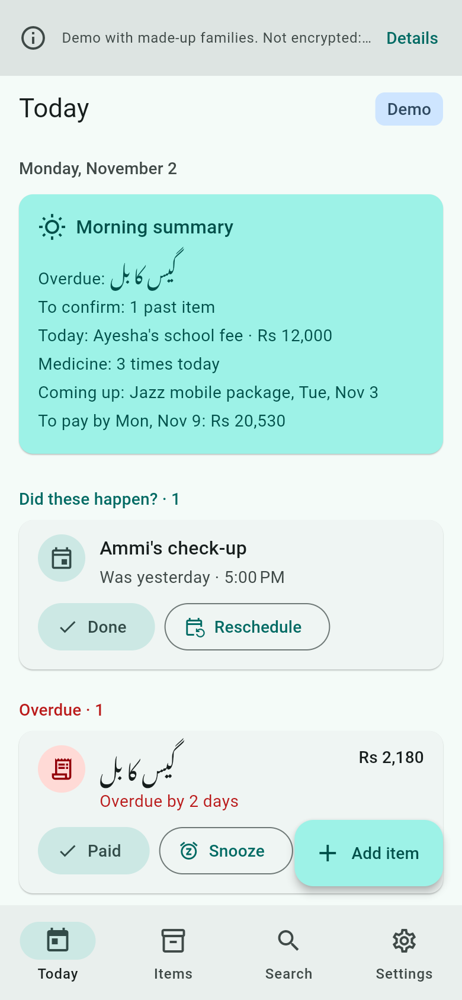
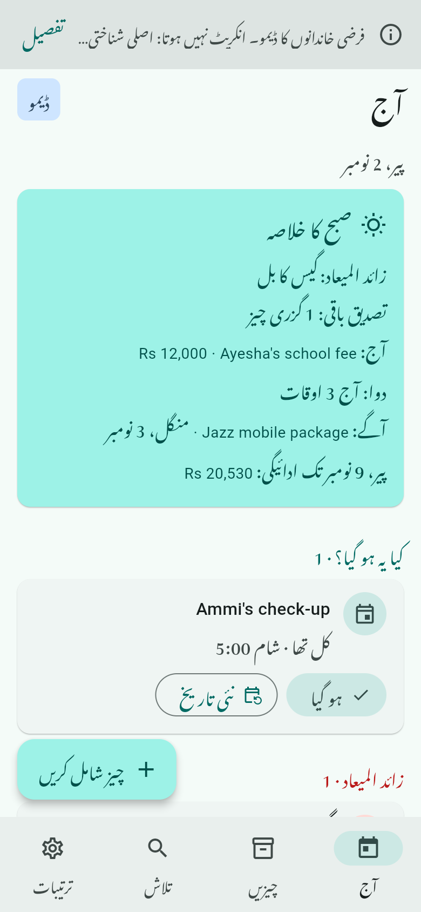
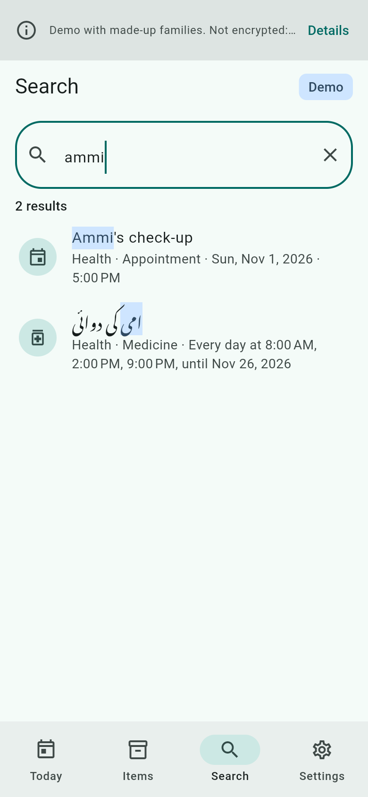
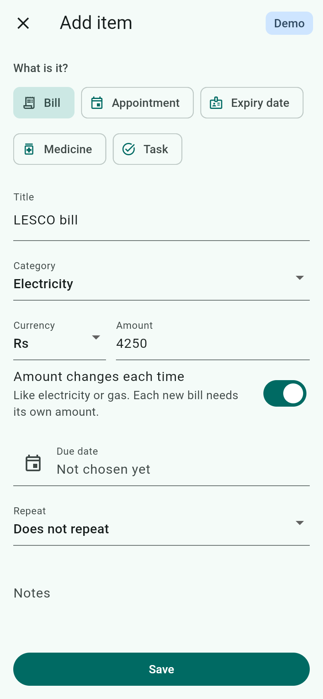
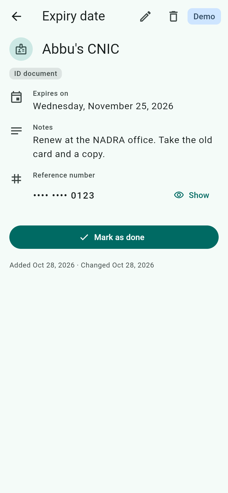
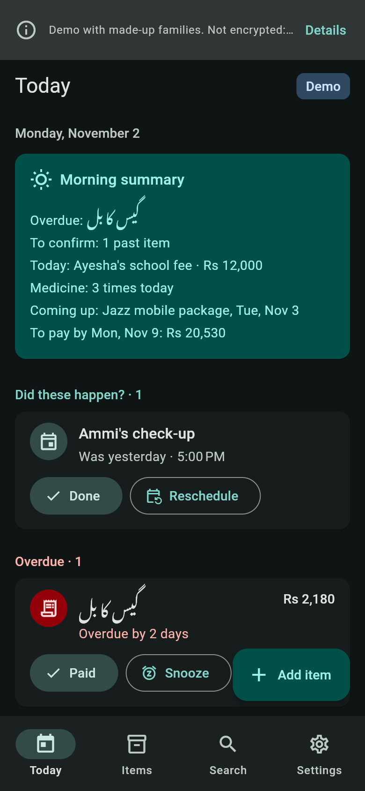

# Yaadi: paper to reminder

Yaadi is for the person who handles a family's bills, notices and medicines. It turns each paper into a reminder they can read in their own language, so they can act on time, every day. Pakistan first (Urdu, Roman Urdu and English), and English-speaking homes in the UK and US. It works offline.

This is Milestone 1 (version 0.1.0): the app, its encrypted storage, the Today screen, offline search in three ways of writing, and a web demo with two made-up households. Nothing is in an app store yet.

## Screenshots

| Today | Today in Urdu | Search |
| --- | --- | --- |
|  |  |  |

| Adding an item | An item's page | Dark theme |
| --- | --- | --- |
|  |  |  |

## The problem

- A bill's due date hides in small English print. Miss it and a late fee follows, and in many homes one person reads every paper for everyone.
- A school fee notice arrives as a WhatsApp forward and gets buried. Nobody remembers whether Ammi's tablet is for the morning or the night. An expired ID card is noticed at the counter.
- ChatGPT can read a bill once. Nothing reminds you next month, and nothing works without the internet.

## What Milestone 1 does

- **Today, at a glance.** A morning summary worked out on the phone ("Overdue: gas bill", "To pay by Mon, Nov 9: Rs 20,530"), then past appointments to confirm, overdue items, today, the next 7 days and later. Expiry dates show 30 days early, because renewing an ID card takes weeks.
- **Paid, Done, Snooze and Undo.** Paying a monthly bill moves it to next month and keeps its day: a bill on the 31st falls on 28 or 29 February and is back on 31 March. A bill paid months late asks what to do with the missed ones, and utility bills never invent arrears. Every action can be undone, and a double tap counts once.
- **Medicine times you type.** Each day's times are marked one by one, in any order. Yaadi never suggests a medicine, a dose or a time, and never calls a dose "missed".
- **Items added by hand.** Bills, appointments, expiry dates, medicine and tasks, with amounts in rupees, pounds or dollars, repeats (daily, weekly, monthly, yearly, or medicine times), end dates and notes. A reference number such as a CNIC or consumer number is hidden until you tap Show, and an ID number typed into the title is offered a move into it.
- **Search in English, Urdu and Roman Urdu.** "bijli ka bill", "بجلی کا بل" and "electricity" find the same LESCO bill; "ammi ki dawai" finds "امی کی دوائی"; "lesco" never finds an IESCO bill. Typos are forgiven and the matched words are highlighted. It runs on the phone, offline.
- **English and Urdu.** Full right-to-left layout, Noto Nastaliq Urdu with room for its tall letters, dates and numbers in each language, and text you type keeps its own direction in either interface. Light and dark themes, a Large text setting, screen reader labels and 48 dp touch targets.
- **Demo households.** The Khan family in Lahore and the Taylor family in Manchester, both made up. On a phone they are shown from memory and your own items are never touched; one tap goes back. The web demo is always a demo and keeps what you type in that browser tab only.

## Roadmap

- **M2:** reminders that still fire after a restart or a time-zone change, and repair themselves; a home-screen widget; the morning summary on a schedule; a first export, since there is no backup yet.
- **M3:** capture by camera, PDF or the share button. A small server, reusing the proxy from our flutter-ai-chat-starter project, reads the paper into a card you check and confirm, with each number linked to where it came from.
- **M4:** voice, Explain in Urdu, Roman Urdu or English, Ask my papers, sharing to WhatsApp, app lock and a simple mode.

## How it is built

- **Flutter 3.47.8 and Riverpod 3**, organised by feature (items, today, search, settings, demo), with the domain logic in plain Dart: recurrence and roll-forward, Today grouping, the morning summary and search have no Flutter or database code and run the same on phones, the web and the test VM.
- **An encrypted vault on phones.** Drift over SQLCipher, with a random key made on the phone, kept by Android Keystore or the iOS Keychain and turned into the database key with HKDF. The open path refuses to run on plain SQLite, a failure never silently resets the vault, and a versioned schema has a migration test harness.
- **One repository contract, three implementations.** The vault, memory (the demo households) and the browser session (the web demo) pass the same tests for revision checks, one payment per occurrence and undo.
- **Dates are calendar dates.** "Due on the 10th" is stored as a date, not an instant, so daylight saving and time-zone changes never move it.

[ARCHITECTURE.md](ARCHITECTURE.md) has the whole design: the threat model, every decision with its trade-off, and what changed while building it.

## Privacy

The Android and iPhone builds are set up to use SQLCipher. Encryption has not been tested yet: the tests are written and skipped until the SQLCipher test library is enabled, and on-device checks come in M2.

> On Android and iPhone, Yaadi keeps your items in an encrypted database on the phone (SQLCipher, AES-256). The key is created on the phone, held by Android Keystore or the iOS Keychain, and never leaves it. This version makes no network requests and has no analytics or crash reporting. Encryption protects a copy of the database file on its own. It does not protect against someone who can unlock your phone and open Yaadi, a rooted or jailbroken phone, or malware. On a shared phone, the main protection is that the Reference field is hidden until you tap Show. There is no backup yet: if you lose or reset your phone, your Yaadi data cannot be recovered.

The web build is a demo:

> Demo with made-up families. What you type stays in this browser, is not encrypted and is not sent to us. Do not enter real ID numbers. The demo is hosted on GitHub Pages, which keeps standard access logs.

The two links in Settings open GitHub and Upwork in your browser; the app itself requests nothing.

## Run it

You need Flutter 3.47.8 (Dart 3.13.7).

```sh
flutter pub get
flutter run -d chrome
```

The web build opens on the household picker. To make the demo show the same dates every time, as the screenshots do, pin today's date:

```sh
flutter run -d chrome --dart-define=YAADI_TODAY=2026-11-02
flutter build web --release --no-web-resources-cdn
```

Android and iOS builds are configured but are not part of Milestone 1: they bundle the SQLCipher library, whose download is still an open decision (ARCHITECTURE.md section 5.1).

## Tests

```sh
flutter analyze
flutter test
```

Over 800 tests run without a network, a device or a real clock:

- table-driven domain tests for recurrence (month ends, leap years, `until`), catch-up, Today grouping, medicine times, the morning summary, money and Urdu digits, the editor's rules and the reference mask;
- 90 search queries in English, Urdu script and Roman Urdu, normalizer rules, highlight boundaries and a 5,000-item time budget;
- one repository contract run against the vault, memory and the browser session, plus the vault's key handling, startup states and migrations;
- widget tests of the main flows in English and Urdu with the real fonts loaded: quick actions and undo, the editor, hidden reference numbers, search highlights, the demo households, right-to-left layout and large text at 2x;
- Flutter's tap-target and label guidelines on six screens in both languages and themes, its contrast guideline on the English screens (it cannot measure thin Nastaliq strokes), and every colour pair of the theme checked at 4.5:1 for both.

The encryption tests are written and skipped until the SQLCipher test library is approved. GitHub Actions runs the same checks on every push: generated code must be up to date, then format, analyze, the tests (and the time tests again under London, New York and Karachi time zones) and a release web build.

Generated code is committed. After changing ARB files, tables or the schema, regenerate it:

```sh
flutter gen-l10n
dart run build_runner build
dart run drift_dev make-migrations
```

## Licences

Yaadi is released under the [MIT License](LICENSE). It bundles Noto Nastaliq Urdu (SIL Open Font License 1.1) and Roboto (Apache License 2.0); both licences ship in `assets/fonts` and appear on the in-app licence page. The Urdu text is a draft until a native speaker reviews it.

## Built by Oriental Tech Solutions

Yaadi is built by [Oriental Tech Solutions](https://github.com/OrientalTechSolutions), a Flutter studio in Lahore, Pakistan, founded by Attaullah Hazarvi. We have been building mobile apps for 13+ years and now focus on iOS and Android apps with AI features built in.

If you need an offline-first app, Urdu and right-to-left support or a complete Flutter app built on the same foundations, we would be glad to help.

**Hire us on Upwork:** https://www.upwork.com/freelancers/attaullahhazarvi
